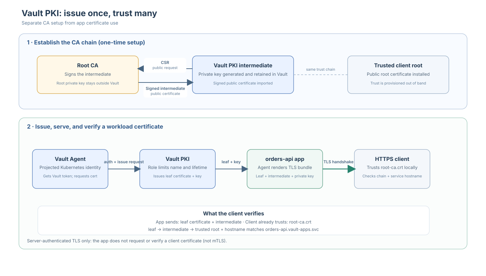

# HTTPS workload and Vault PKI

This guide adds the HTTPS demo app and Vault-issued certificates to the
Vault and Kubernetes-auth lab. Complete steps 1–5 of
[the core lab guide](./OPENSHIFT_KUBERNETES_AUTH.md) first.

The runtime architecture is shown in the [README](./README.md). In this pod,
Vault Agent receives the projected ServiceAccount token, authenticates to
Vault, and renders the permitted KV data and issued certificate into files
the app reads from a shared volume. The app does not receive the Kubernetes
or Vault token. Vault API trust and app TLS trust are separate: the operator
trusts the Vault API CA, while app clients trust the PKI root.



## 6. Deploy the HTTPS workload

Deploy the small Python HTTPS application in `apps/orders-api/app.py` using
the existing `orders-api` ServiceAccount. Terraform mounts the source from a
ConfigMap, so no custom image build is required. The application runs under
OpenShift's assigned non-root UID and serves only through an internal
ClusterIP Service.

The pod uses automatic ServiceAccount-token mounting disabled. Instead, a
short-lived projected token is mounted only into the Vault Agent sidecar,
not the app container. Agent authenticates to Vault as `orders-api`, reads
only that role's permitted `apps/orders/config` secret, and renders it to a
shared in-memory volume. The app reads the config file on each `/config`
request.

To deploy the app before PKI is configured, create a temporary certificate.
This is only a bootstrap convenience; the final setup uses a Vault-issued
certificate signed by the PKI intermediate. Keep this temporary CA separate
from both Vault's API CA and the final PKI root:

```sh
APP_TLS_DIR="$HOME/.vault-openshift-lab/orders-api"
mkdir -p "$APP_TLS_DIR"
chmod 700 "$APP_TLS_DIR"
OPENSSL="$(brew --prefix openssl@3)/bin/openssl"

"$OPENSSL" req -x509 -newkey rsa:3072 -sha256 -nodes -days 30 \
  -keyout "$APP_TLS_DIR/demo-ca.key" \
  -out "$APP_TLS_DIR/demo-ca.crt" \
  -subj "/CN=Orders API Temporary Lab CA" \
  -addext "basicConstraints=critical,CA:TRUE" \
  -addext "keyUsage=critical,keyCertSign,cRLSign"

"$OPENSSL" req -new -newkey rsa:3072 -sha256 -nodes \
  -keyout "$APP_TLS_DIR/tls.key" \
  -out "$APP_TLS_DIR/tls.csr" \
  -subj "/CN=orders-api.vault-apps.svc" \
  -addext "subjectAltName=DNS:orders-api,DNS:orders-api.vault-apps,DNS:orders-api.vault-apps.svc,DNS:orders-api.vault-apps.svc.cluster.local" \
  -addext "keyUsage=critical,digitalSignature,keyEncipherment" \
  -addext "extendedKeyUsage=serverAuth"

"$OPENSSL" x509 -req -sha256 -days 30 \
  -in "$APP_TLS_DIR/tls.csr" \
  -CA "$APP_TLS_DIR/demo-ca.crt" \
  -CAkey "$APP_TLS_DIR/demo-ca.key" \
  -CAcreateserial \
  -copy_extensions copy \
  -out "$APP_TLS_DIR/tls.crt"

chmod 600 "$APP_TLS_DIR/demo-ca.key" "$APP_TLS_DIR/tls.key"
"$OPENSSL" verify -CAfile "$APP_TLS_DIR/demo-ca.crt" "$APP_TLS_DIR/tls.crt"

oc create secret tls orders-api-tls \
  --namespace vault-apps \
  --cert="$APP_TLS_DIR/tls.crt" \
  --key="$APP_TLS_DIR/tls.key"
```

Create the TLS Secret with `oc` rather than Terraform so the private key is
not copied into Terraform state. The Secret is still stored in the cluster;
this is a lab shortcut, and production should use protected secret delivery
and storage. Terraform reads the public Vault API CA certificate from
`$HOME/.vault-openshift-lab/ca.crt`, creates the Agent configuration and app
ConfigMap, then deploys the app and Agent containers:

```sh
terraform -chdir=terraform/openshift plan \
  -var='enable_kubernetes_auth=true'
terraform -chdir=terraform/openshift apply \
  -var='enable_kubernetes_auth=true'
oc rollout status deployment/orders-api -n vault-apps
oc get pods,services -n vault-apps
```

Wait until both containers are ready, then check the Agent logs for a
successful Kubernetes auth login and template render:

```sh
oc get pods -n vault-apps -l app=orders-api
oc logs deployment/orders-api -n vault-apps -c vault-agent
```

The Kubernetes auth login uses the pod's projected token and the `orders-api`
Vault role. Vault asks the Kubernetes API to validate that token using
TokenReview, then issues a Vault token with the `orders-api-read` policy.
Neither the projected Kubernetes token nor the resulting Vault token is
mounted into the app container.

You can also confirm the token file is visible to the Agent but not the app
without printing the token contents:

```sh
oc exec deployment/orders-api -n vault-apps -c vault-agent -- \
  test -s /var/run/secrets/vault-auth/token
oc exec deployment/orders-api -n vault-apps -c orders-api -- \
  sh -c 'test ! -e /var/run/secrets/vault-auth/token'
```

The workload is internal-only; the port-forward is temporary and no
OpenShift Route is created. The demo secret is non-sensitive. The `/config`
endpoint returns that fake value to make Agent rendering observable; do not
use this pattern for real secrets. The remaining sections replace the
temporary certificate and verify the final PKI-backed setup.

## 7. Add an offline root and Vault PKI intermediate

This step replaces the app's temporary TLS certificate with one issued by
Vault. The root CA key signs Vault's intermediate CSR and stays out of Vault;
Vault generates and keeps the intermediate private key internally. The root
key is needed only when signing or renewing an intermediate. The diagram
above connects this one-time setup to the runtime certificate issuance and
client-verification flow.

### What the PKI secrets engine does

`pki_int` is the mount path chosen for this lab; it is not a special engine
type. The mount is a Vault **PKI secrets engine**, configured here as an
intermediate CA. Unlike KV, which stores arbitrary key/value data, a PKI
engine understands certificates: it uses CA key material to issue
role-constrained certificates, can generate the leaf key and return it with
the certificate, and tracks issued certificates for lifecycle operations such
as revocation and CRL publication. The `orders-api` role limits which service
name can be issued and for how long.

For the lab, keep the root key in a private directory and use it only for the
manual signing step. A key on the same workstation is not truly offline:
production should keep the root key on an isolated system or HSM, with
controlled access, backups, and documented ceremonies. Do not reuse the
separate CA that signs Vault's API certificate.

Create a dedicated directory and a root CA if you do not already have one.
Do not rerun root creation to reset the lab; preserve the root certificate
and protect its private key. OpenSSL 3 uses `-cipher aes-256-cbc` to encrypt
the generated key and will prompt for a passphrase:

```sh
PKI_ROOT_DIR="$HOME/.vault-openshift-lab/offline-root"
mkdir -p "$PKI_ROOT_DIR"
chmod 700 "$PKI_ROOT_DIR"
umask 077
OPENSSL="$(brew --prefix openssl@3)/bin/openssl"

"$OPENSSL" req -x509 -newkey rsa:4096 -sha256 \
  -cipher aes-256-cbc -days 3650 \
  -keyout "$PKI_ROOT_DIR/root-ca.key" \
  -out "$PKI_ROOT_DIR/root-ca.crt" \
  -subj "/CN=OpenShift Vault Lab Offline Root" \
  -addext "basicConstraints=critical,CA:TRUE,pathlen:1" \
  -addext "keyUsage=critical,keyCertSign,cRLSign"

chmod 600 "$PKI_ROOT_DIR/root-ca.key"
```

Ask Terraform to mount the intermediate PKI engine and generate an
intermediate private key inside Vault. This first phase does not issue app
certificates. Review the plan before applying:

```sh
terraform -chdir=terraform/openshift plan \
  -var='enable_kubernetes_auth=true' \
  -var='enable_pki=true'
terraform -chdir=terraform/openshift apply \
  -var='enable_kubernetes_auth=true' \
  -var='enable_pki=true'
```

Export the resulting public CSR. `type = "internal"` asks Vault to generate
and retain the intermediate private key; the CSR itself contains only public
key material. The Terraform provider marks any computed private-key attribute
as sensitive, so protect Terraform state as sensitive data regardless:

```sh
terraform -chdir=terraform/openshift output -raw orders_pki_intermediate_csr \
  > "$PKI_ROOT_DIR/orders-intermediate.csr"
```

Sign the CSR with the offline root key. The path length constraint prevents
this intermediate from creating further subordinate CAs:

```sh
cat > "$PKI_ROOT_DIR/intermediate-extensions.cnf" <<'EOF'
[v3_intermediate_ca]
basicConstraints = critical,CA:TRUE,pathlen:0
keyUsage = critical,keyCertSign,cRLSign
subjectKeyIdentifier = hash
authorityKeyIdentifier = keyid:always,issuer
EOF

"$OPENSSL" x509 -req -sha256 -days 1825 \
  -in "$PKI_ROOT_DIR/orders-intermediate.csr" \
  -CA "$PKI_ROOT_DIR/root-ca.crt" \
  -CAkey "$PKI_ROOT_DIR/root-ca.key" \
  -CAcreateserial \
  -extfile "$PKI_ROOT_DIR/intermediate-extensions.cnf" \
  -extensions v3_intermediate_ca \
  -out "$PKI_ROOT_DIR/orders-intermediate.crt"

"$OPENSSL" verify -CAfile "$PKI_ROOT_DIR/root-ca.crt" \
  "$PKI_ROOT_DIR/orders-intermediate.crt"
cat "$PKI_ROOT_DIR/orders-intermediate.crt" "$PKI_ROOT_DIR/root-ca.crt" \
  > "$PKI_ROOT_DIR/orders-intermediate-chain.pem"
```

Pass the signed intermediate plus root certificate to Terraform. Only public
certificates are in this bundle; the root private key stays outside Terraform
and Vault:

```sh
terraform -chdir=terraform/openshift plan \
  -var='enable_kubernetes_auth=true' \
  -var='enable_pki=true' \
  -var="pki_intermediate_chain_path=$PKI_ROOT_DIR/orders-intermediate-chain.pem"
terraform -chdir=terraform/openshift apply \
  -var='enable_kubernetes_auth=true' \
  -var='enable_pki=true' \
  -var="pki_intermediate_chain_path=$PKI_ROOT_DIR/orders-intermediate-chain.pem"
```

Terraform imports the signed chain into Vault, configures issuing/CRL URLs,
and creates the `orders-api` PKI role. That role permits only the exact
`orders-api.vault-apps.svc` name, forbids wildcard and IP SANs, and caps
certificate lifetime at 24 hours (Agent requests ten-minute certificates).
Only the `orders-api` Vault policy gains permission to issue certificates
from this role; `payments-api` does not.

The lab's issuer and CRL URLs use Vault's in-cluster Service DNS name. In
production, configure URLs reachable by the intended certificate consumers
and publish the root CA through an independently trusted channel.

After the rollout, check both pod containers and the Agent logs:

```sh
oc rollout status deployment/orders-api -n vault-apps
oc get pods -n vault-apps -l app=orders-api
oc logs deployment/orders-api -n vault-apps -c vault-agent
```

The Agent's `pkiCert` template writes the leaf, intermediate, and leaf private key
to one file on the shared memory-backed volume. The app uses this bundle
instead of the temporary TLS Secret. It loads the latest bundle for each new
HTTPS connection and reads the KV config file for each `/config` request, so
Agent file updates do not require an app restart.

### Test the final PKI-backed workload

After applying the signed intermediate chain, use the PKI root—not
`demo-ca.crt`—to verify the app's certificate. Start a port-forward and leave
it running in one terminal. The app presents its Vault-issued leaf
certificate; the root certificate is the trust anchor for `curl`, so there
is no need to copy the leaf certificate out of the pod.

```sh
PKI_ROOT_DIR="$HOME/.vault-openshift-lab/offline-root"
oc port-forward -n vault-apps service/orders-api 8443:443
```

In another terminal, set the root path and check TLS trust and app endpoints:

```sh
PKI_ROOT_DIR="$HOME/.vault-openshift-lab/offline-root"
OPENSSL="$(brew --prefix openssl@3)/bin/openssl"

"$OPENSSL" s_client \
  -connect 127.0.0.1:8443 \
  -servername orders-api.vault-apps.svc \
  -CAfile "$PKI_ROOT_DIR/root-ca.crt" \
  -verify_return_error </dev/null

curl --cacert "$PKI_ROOT_DIR/root-ca.crt" \
  --fail --show-error \
  --resolve orders-api.vault-apps.svc:8443:127.0.0.1 \
  https://orders-api.vault-apps.svc:8443/

curl --cacert "$PKI_ROOT_DIR/root-ca.crt" \
  --fail --show-error \
  --resolve orders-api.vault-apps.svc:8443:127.0.0.1 \
  https://orders-api.vault-apps.svc:8443/config
```

### How the client verifies the app

The client needs a trusted copy of `root-ca.crt`. It does not need a local
copy of the intermediate certificate because the app sends the intermediate
along with its leaf certificate during the TLS handshake. In this lab,
Vault Agent renders both into the app's TLS bundle.

```text
App sends during TLS:  orders-api leaf certificate + Vault intermediate
Client trusts locally: root-ca.crt

Verification chain:    leaf → intermediate → trusted root
```

The client checks that the leaf chains to its trusted root, is currently
valid, and names `orders-api.vault-apps.svc`, the hostname in the URL. The
port-forward only routes traffic to the local app; `--resolve` keeps the
service hostname in the URL so TLS can still verify the expected name. The
intermediate is the link between the leaf and the client's trusted root. The
root private key is never sent; it is not needed for client verification.

This is **server-authenticated TLS**, not mutual TLS (mTLS). The client
verifies the app's certificate, but the app does not request or verify a
client certificate. The port-forward and `curl --cacert` establish routing
and server trust; they do not authenticate a user or application client.
mTLS would additionally require the client to present a certificate that the
app (or a TLS-terminating proxy) verifies.

TLS verification should report `Verify return code: 0 (ok)`. The root path
should report that the HTTPS app is running. `/config` should return the
non-sensitive demo values:

```text
service=orders-api
region=lab
```

Test automatic KV config refresh. Run these commands from a terminal where
the Vault CLI is configured with an operator token allowed to write this
demo path. KV v2 values are non-leased (static) secrets. Vault Agent checks
for changes on its `static_secret_render_interval`, which defaults to five
minutes, so the update is not immediate. The Agent's workload token is
read-only.

```sh
vault kv put apps/orders/config service=orders-api region=rotation-test
sleep 5m
oc exec deployment/orders-api -n vault-apps -c orders-api -- \
  cat /vault/secrets/orders-config
curl --cacert "$PKI_ROOT_DIR/root-ca.crt" \
  --fail --show-error \
  --resolve orders-api.vault-apps.svc:8443:127.0.0.1 \
  https://orders-api.vault-apps.svc:8443/config
vault kv put apps/orders/config service=orders-api region=lab
```

The response should show `region=rotation-test`; the last command restores
the original demo value.

To observe certificate rotation, record the serial served now:

```sh
"$OPENSSL" s_client \
  -connect 127.0.0.1:8443 \
  -servername orders-api.vault-apps.svc \
  -showcerts -CAfile "$PKI_ROOT_DIR/root-ca.crt" </dev/null 2>/dev/null |
  sed -n '/-----BEGIN CERTIFICATE-----/,/-----END CERTIFICATE-----/p' |
  "$OPENSSL" x509 -noout -serial -enddate
```

Repeat after Vault Agent has refreshed its ten-minute certificate. The
serial should change without restarting the app; refresh timing is managed
by Agent and is not instantaneous. Vault must be unsealed and reachable for
Agent to renew: if Vault remains unavailable until the short-lived certificate
expires, clients will reject the app's HTTPS connection until a valid
replacement is rendered.

You can also verify that the workload role cannot issue for another name:

```sh
oc exec deployment/orders-api -n vault-apps -c vault-agent -- sh -c '
  export VAULT_ADDR=https://vault.vault-lab.svc:8200
  export VAULT_CACERT=/vault/config/ca.crt
  jwt="$(cat /var/run/secrets/vault-auth/token)"
  token="$(vault write -field=token auth/kubernetes/login \
    role=orders-api jwt="$jwt")"
  VAULT_TOKEN="$token" vault write -field=serial_number \
    pki_int/issue/orders-api \
    common_name=orders-api.vault-apps.svc ttl=1h
  if VAULT_TOKEN="$token" vault write -field=serial_number \
    pki_int/issue/orders-api \
    common_name=payments-api.vault-apps.svc ttl=1h; then
    echo "Unexpected: orders-api issued a payments certificate"
    exit 1
  else
    echo "Expected: issuance for payments-api was denied"
  fi
'
```

The orders app certificate and its key are delivered by Agent, not written to
a Kubernetes Secret or Terraform state. The original `orders-api-tls` Secret
from the temporary-certificate stage is no longer mounted; after verifying
the PKI-backed app works, remove that obsolete Secret:

```sh
oc delete secret orders-api-tls -n vault-apps
```
