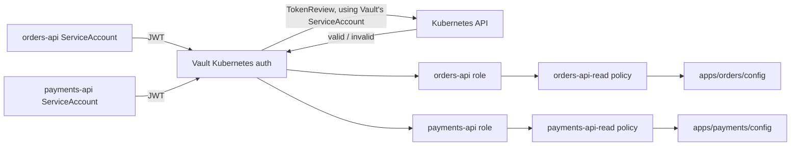

# OpenShift Stage 3 — Kubernetes Authentication

This stage gives two OpenShift workloads distinct identities in Vault. Each
workload uses its Kubernetes ServiceAccount token to authenticate; Vault
validates it with the Kubernetes TokenReview API and returns a short-lived
Vault token containing only that application's policy.



Complete [Stage 2 — Raft and TLS](./OPENSHIFT_VAULT_RAFT_TLS.md) first. Vault
must be running in the `vault-lab` namespace, initialized, unsealed, and
reachable through the TLS port-forward.

## How the TokenReview connection works

The Vault Helm chart's `server.authDelegator.enabled` setting grants the Vault
server ServiceAccount permission to call Kubernetes' TokenReview API. The
Terraform configuration sets the Kubernetes API address to
`https://kubernetes.default.svc` and deliberately omits a long-lived
`token_reviewer_jwt` and a copied CA certificate. Because Vault runs inside
the cluster, it uses its mounted ServiceAccount token and CA file. HashiCorp
recommends this local-token approach for current Vault versions; the Vault
ServiceAccount must retain its `system:auth-delegator` binding.

The backend config disables Vault's separate issuer-claim check because
issuer formats vary between Kubernetes/OpenShift versions. Kubernetes still
validates the presented ServiceAccount JWT through TokenReview; this setting
does not skip signature, expiry, or TokenReview validation.

The Terraform Kubernetes provider manages a separate `vault-apps` namespace
and two ServiceAccounts. Vault roles bind to the exact ServiceAccount and
namespace names—no wildcards. These resources are opt-in: this stage's
Terraform commands set `enable_kubernetes_auth=true`. The default is `false`,
so Stages 1 and 2 do not try to contact Vault.

## 1. Connect Terraform to the cluster and Vault

Confirm that `oc` points to the intended OpenShift cluster and the Vault
server is reachable. Start the port-forward in a terminal and leave it running:

```sh
oc port-forward -n vault-lab service/vault 8200:8200
```

In the terminal where Terraform will run, configure the local HTTPS connection
and use the initial Vault root token from Stage 2:

```sh
export VAULT_ADDR=https://127.0.0.1:8200
export VAULT_CACERT="$HOME/.vault-openshift-lab/ca.crt"
export VAULT_TLS_SERVER_NAME=vault.vault-lab.svc
printf "Vault root token: "
IFS= read -r -s VAULT_TOKEN
printf '\n'
export VAULT_TOKEN
vault status
oc whoami
```

Enter the initial root token from Stage 2 at the prompt. The root token has
full Vault administrative access and is used only because this disposable
course lab is creating auth configuration. Do not put it in Terraform files,
shell commands, or source control.

Terraform uses the current kubeconfig context at `~/.kube/config` by default.
If you need to select a context explicitly, pass it as a Terraform variable:

```sh
terraform -chdir=terraform/openshift plan \
  -var='vault_profile=raft-tls' \
  -var='enable_kubernetes_auth=true' \
  -var='kube_context=<your-openshift-context>'
```

Use the same variables on subsequent `apply` and `destroy` commands.

## 2. Review and apply the authentication configuration

The configuration in
[terraform/openshift/kubernetes-auth.tf](./terraform/openshift/kubernetes-auth.tf)
creates:

- A KV v2 `apps/` mount and fake `orders/config` and `payments/config` lab
  values.
- Separate read-only policies for the two paths.
- A Kubernetes auth mount and roles bound to each application's ServiceAccount
  in `vault-apps`.
- The `vault-apps` namespace and both ServiceAccounts.

The demo values are not real credentials. The Terraform state contains them;
keep the state private.

Initialize Terraform to install the Vault and Kubernetes providers, then
format, validate, and review the plan:

```sh
terraform -chdir=terraform/openshift init
terraform -chdir=terraform/openshift fmt -check
terraform -chdir=terraform/openshift validate
terraform -chdir=terraform/openshift plan \
  -var='vault_profile=raft-tls' \
  -var='enable_kubernetes_auth=true'
```

The plan should preserve the existing Vault Helm release and add Kubernetes
auth, policies, demo KV data, a namespace, and ServiceAccounts. Review the
target cluster and every planned resource before applying:

```sh
terraform -chdir=terraform/openshift apply \
  -var='vault_profile=raft-tls' \
  -var='enable_kubernetes_auth=true'
```

Type `yes` only after reviewing the plan. Check that the namespace and
ServiceAccounts exist:

```sh
oc get namespace vault-apps
oc get serviceaccount -n vault-apps
```

## 3. Authenticate as `orders-api`

Create a short-lived token for the `orders-api` ServiceAccount. This uses
Kubernetes' TokenRequest API; it does not create a long-lived token Secret:

```sh
ORDERS_JWT="$(oc create token orders-api \
  --namespace vault-apps \
  --duration=10m)"
```

Exchange that JWT for a short-lived Vault token. The response token is kept in
a shell variable rather than printed:

```sh
ORDERS_VAULT_TOKEN="$(vault write -field=token auth/kubernetes/login \
  role=orders-api \
  jwt="$ORDERS_JWT")"
```

Confirm the role can read its own data:

```sh
VAULT_TOKEN="$ORDERS_VAULT_TOKEN" vault kv get apps/orders/config
```

Then prove it cannot read the other application's path:

```sh
if VAULT_TOKEN="$ORDERS_VAULT_TOKEN" vault kv get apps/payments/config; then
  echo "Unexpected: orders-api could read payments data"
  exit 1
else
  echo "Expected: orders-api cannot read payments data"
fi
```

The denial is expected. The role restricts authentication to the `orders-api`
ServiceAccount, and its token carries only the `orders-api-read` policy.

If `oc create token` is denied by cluster permissions, ask the cluster
administrator for permission to request a short-lived token for these lab
ServiceAccounts. Do not work around the restriction by creating a
non-expiring token Secret.

## 4. Authenticate as `payments-api`

Repeat the test for the other ServiceAccount:

```sh
PAYMENTS_JWT="$(oc create token payments-api \
  --namespace vault-apps \
  --duration=10m)"
PAYMENTS_VAULT_TOKEN="$(vault write -field=token auth/kubernetes/login \
  role=payments-api \
  jwt="$PAYMENTS_JWT")"
VAULT_TOKEN="$PAYMENTS_VAULT_TOKEN" vault kv get apps/payments/config
```

Try `apps/orders/config` with `PAYMENTS_VAULT_TOKEN`; it should be denied.
You can also try logging the `orders-api` token in against the
`payments-api` auth role. That authentication should fail because the role is
bound to a different ServiceAccount.

The test requests tokens with `oc` for clarity, but uses the same short-lived
ServiceAccount token mechanism that a pod receives. Applications should
request Vault tokens from inside the workload and keep both tokens in memory.
The next integration stage can deliver Vault secrets or certificates to
workloads without operators manually copying tokens.

## Reset the lab

When you are ready to remove the deployment and its data, follow
[Stage 1's reset procedure](./OPENSHIFT_VAULT.md#reset-the-lab-for-a-fresh-terraform-deployment).

For Vault Agent or Vault Secrets Operator integrations, certificate issuance
and renewal, and mTLS between applications, continue to a separate
application-integration stage after this authentication flow is working.
