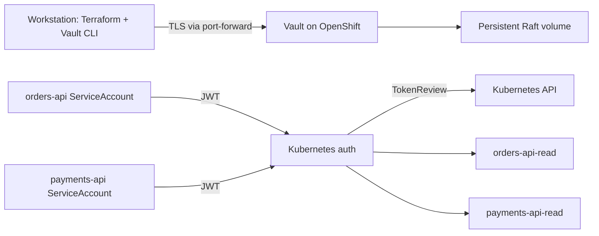

# OpenShift Vault: Raft, TLS, and Kubernetes authentication

Build the complete lab from scratch on OpenShift Local (CRC) or another
OpenShift cluster. The result is a single-node Vault server with persistent
integrated Raft storage, TLS, and separate Vault policies for two workload
ServiceAccounts.

This is a learning setup, not a production design. A single Vault node is not
highly available, and it uses manual Shamir unsealing.



## Requirements

- A running OpenShift cluster and a working `oc` login. For CRC, run
  `crc start` and verify `oc whoami` before continuing; see
  [Prerequisites](./PREREQUISITES.md) for workstation, cluster, and access
  requirements.
- Terraform 1.5 or later, Helm 3, OpenSSL 3, and the Vault CLI.
- Permission to create namespaces, a Helm release, persistent volumes, and
  Kubernetes ServiceAccounts. The Vault ServiceAccount must be allowed to
  call Kubernetes TokenReview; the chart configuration below grants this.
- Internet access for Helm chart and Terraform provider downloads.

The lab uses Vault Community Edition. Review its license terms if your use
goes beyond personal learning. Confirm that `oc` targets the intended cluster
before continuing:

```sh
oc whoami
oc whoami --show-server
oc get nodes
terraform version
helm version
openssl version
vault version
```

## 1. Create the lab TLS certificate

This is Vault's server certificate. Its subject alternative names cover the
Vault Service and the `vault-0` pod, so clients can verify Vault when
connecting through either DNS name. Raft is Vault's integrated storage
backend running in the Vault pod. Keep the CA and
server private keys outside the repository:

```sh
TLS_DIR="$HOME/.vault-openshift-lab"
mkdir -p "$TLS_DIR"
chmod 700 "$TLS_DIR"

openssl req -x509 -newkey rsa:3072 -sha256 -nodes -days 365 \
  -keyout "$TLS_DIR/ca.key" \
  -out "$TLS_DIR/ca.crt" \
  -subj "/CN=Vault OpenShift Learning CA" \
  -addext "basicConstraints=critical,CA:TRUE" \
  -addext "keyUsage=critical,keyCertSign,cRLSign"

openssl req -new -newkey rsa:3072 -nodes \
  -keyout "$TLS_DIR/tls.key" \
  -out "$TLS_DIR/tls.csr" \
  -subj "/CN=vault.vault-lab.svc" \
  -addext "subjectAltName=DNS:vault,DNS:vault.vault-lab,DNS:vault.vault-lab.svc,DNS:vault.vault-lab.svc.cluster.local,DNS:vault-0.vault-internal,DNS:vault-0.vault-internal.vault-lab.svc,DNS:vault-0.vault-internal.vault-lab.svc.cluster.local"

openssl x509 -req -sha256 -days 365 \
  -in "$TLS_DIR/tls.csr" \
  -CA "$TLS_DIR/ca.crt" \
  -CAkey "$TLS_DIR/ca.key" \
  -CAcreateserial \
  -copy_extensions copy \
  -out "$TLS_DIR/tls.crt"

chmod 600 "$TLS_DIR/ca.key" "$TLS_DIR/tls.key"
openssl verify -CAfile "$TLS_DIR/ca.crt" "$TLS_DIR/tls.crt"
```

The verification command should report `OK`. Create the TLS Secret in the
Vault namespace; Helm creates that namespace during the next step:

```sh
oc create namespace vault-lab
oc create secret generic vault-server-tls \
  --namespace vault-lab \
  --from-file=tls.crt="$TLS_DIR/tls.crt" \
  --from-file=tls.key="$TLS_DIR/tls.key" \
  --from-file=ca.crt="$TLS_DIR/ca.crt"
```

The Secret contains a private key. Do not print it, commit it, or share it.

## 2. Deploy Vault

The final Helm configuration is in
[terraform/openshift/values-raft-tls.yaml](./terraform/openshift/values-raft-tls.yaml).
It enables TLS, persistent Raft storage, and the Vault ServiceAccount's
TokenReview permissions. There is no development-mode deployment.

Terraform uses the current kubeconfig context by default. Initialize and
review the initial plan. At this point Kubernetes auth is disabled because
Vault must be initialized before Terraform can configure its auth API:
the Terraform variable defaults to `true` for the completed lab, so explicitly
set it to `false` for this first deployment.

```sh
terraform -chdir=terraform/openshift init
terraform -chdir=terraform/openshift fmt -check
terraform -chdir=terraform/openshift validate
terraform -chdir=terraform/openshift plan \
  -var='enable_kubernetes_auth=false'
```

After confirming that the plan targets the intended cluster, deploy Vault:

```sh
terraform -chdir=terraform/openshift apply \
  -var='enable_kubernetes_auth=false'
```

Wait for the pod and persistent volume claim to appear:

```sh
oc get pods,pvc -n vault-lab
```

The pod will not become Ready until Vault is initialized and unsealed.

## 3. Initialize and unseal Vault

Initialize the single-node server once. Store the unseal key and initial root
token in a password manager; they cannot be recovered if lost:

```sh
oc exec -it -n vault-lab vault-0 -- env \
  VAULT_ADDR=https://vault-0.vault-internal.vault-lab.svc:8200 \
  VAULT_CACERT=/vault/userconfig/vault-tls/ca.crt \
  vault operator init -key-shares=1 -key-threshold=1
```

Do not run `operator init` again for this Vault data directory. Enter the
unseal key at the prompt:

```sh
oc exec -it -n vault-lab vault-0 -- env \
  VAULT_ADDR=https://vault-0.vault-internal.vault-lab.svc:8200 \
  VAULT_CACERT=/vault/userconfig/vault-tls/ca.crt \
  vault operator unseal
```

Check the pod becomes Ready:

```sh
oc get pods -n vault-lab --watch
```

Continue when `vault-0` shows `1/1 Ready`, then press **Ctrl+C**.

## 4. Connect to Vault and configure Kubernetes auth

Start a port-forward and leave it running:

```sh
oc port-forward -n vault-lab service/vault 8200:8200
```

In the terminal where you will run Terraform, set up TLS and enter the initial
root token at a hidden prompt:

```sh
export VAULT_ADDR=https://127.0.0.1:8200
export VAULT_CACERT="$HOME/.vault-openshift-lab/ca.crt"
export VAULT_TLS_SERVER_NAME=vault.vault-lab.svc
printf "Vault root token: "
IFS= read -r -s VAULT_TOKEN
printf '\n'
export VAULT_TOKEN
vault status
```

The status should report that Vault is initialized and unsealed. Terraform
now creates a KV v2 `apps/` mount with fake demo values, read-only policies,
the `vault-apps` namespace and ServiceAccounts, and the Kubernetes auth
backend and roles:

```sh
terraform -chdir=terraform/openshift plan \
  -var='enable_kubernetes_auth=true'
```

Review the complete plan, then apply:

```sh
terraform -chdir=terraform/openshift apply \
  -var='enable_kubernetes_auth=true'
```

Check the workload identities were created:

```sh
oc get serviceaccounts -n vault-apps
```

Terraform state contains the demo values. Keep it private and do not put real
credentials in the demo data.

### Why TokenReview works

Vault calls the in-cluster Kubernetes API at
`https://kubernetes.default.svc`. The Helm chart's
`server.authDelegator.enabled` setting gives the Vault ServiceAccount
permission to call TokenReview. Vault uses its mounted ServiceAccount token
and CA; the configuration does not store a long-lived reviewer token or a
copied CA certificate. The Kubernetes auth backend disables its separate
issuer-claim check because issuer formats vary across cluster versions;
Kubernetes still validates each JWT through TokenReview.

## 5. Test workload access

Request a short-lived Kubernetes token for `orders-api`, exchange it for a
Vault token, and read its own data:

```sh
ORDERS_JWT="$(oc create token orders-api \
  --namespace vault-apps \
  --duration=10m)"
ORDERS_VAULT_TOKEN="$(vault write -field=token auth/kubernetes/login \
  role=orders-api \
  jwt="$ORDERS_JWT")"
VAULT_TOKEN="$ORDERS_VAULT_TOKEN" vault kv get apps/orders/config
```

The orders identity must not read payments data:

```sh
if VAULT_TOKEN="$ORDERS_VAULT_TOKEN" vault kv get apps/payments/config; then
  echo "Unexpected: orders-api could read payments data"
  exit 1
else
  echo "Expected: orders-api cannot read payments data"
fi
```

Repeat for `payments-api`:

```sh
PAYMENTS_JWT="$(oc create token payments-api \
  --namespace vault-apps \
  --duration=10m)"
PAYMENTS_VAULT_TOKEN="$(vault write -field=token auth/kubernetes/login \
  role=payments-api \
  jwt="$PAYMENTS_JWT")"
VAULT_TOKEN="$PAYMENTS_VAULT_TOKEN" vault kv get apps/payments/config
```

Try reading `apps/orders/config` with `PAYMENTS_VAULT_TOKEN`; it should be
denied. If `oc create token` is denied, ask the cluster administrator for
permission to request short-lived tokens. Do not create non-expiring token
Secrets as a workaround.

The tests request tokens with `oc` for clarity. In a real workload, the
application uses its projected ServiceAccount token and keeps the Vault token
in memory.

## Restarting Vault

Vault's Raft data is persisted on persistent volume storage (PV), accessed through a PVC, but this lab uses manual unsealing. After a
Vault pod restart, check status and unseal it with the saved key; do not
initialize it again:

```sh
oc exec -it -n vault-lab vault-0 -- env \
  VAULT_ADDR=https://vault-0.vault-internal.vault-lab.svc:8200 \
  VAULT_CACERT=/vault/userconfig/vault-tls/ca.crt \
  vault operator unseal
```

## Remove the lab

This permanently deletes Vault data and its workload identities. Ensure
`oc` targets the intended cluster, the port-forward is running, and Vault is
unsealed. In the Terraform terminal, verify TLS access and the root token are
still set, then remove the Vault configuration before uninstalling Vault:

```sh
oc whoami --show-server
terraform -chdir=terraform/openshift apply \
  -var='enable_kubernetes_auth=false'
terraform -chdir=terraform/openshift destroy \
  -var='enable_kubernetes_auth=false'
oc delete namespace vault-lab --wait=true
```

Inspect persistent volumes after namespace deletion. If a lab volume remains,
confirm its claim and that its data can be discarded before deleting that
specific PV:

```sh
oc get pv -o custom-columns=NAME:.metadata.name,STATUS:.status.phase,CLAIM:.spec.claimRef.name,NAMESPACE:.spec.claimRef.namespace,RECLAIM:.spec.persistentVolumeReclaimPolicy
```

Keep `$HOME/.vault-openshift-lab` if you want to retain the lab CA. Otherwise,
remove that specific directory only after confirming you no longer need its
keys or certificates. Keep Terraform state private; it may contain Vault
configuration and values.
