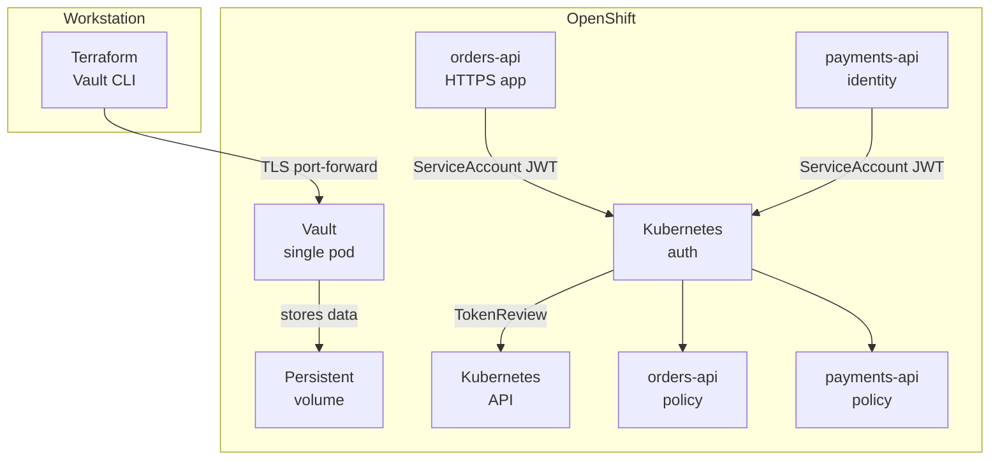

# OpenShift Vault: Raft, TLS, and Kubernetes authentication

Build the complete lab from scratch on OpenShift Local (CRC) or another
OpenShift cluster. The result is a single-node Vault server with persistent
integrated Raft storage, TLS, and separate Vault policies for two workload
ServiceAccounts. It also deploys a minimal HTTPS application using the
`orders-api` ServiceAccount.

This is a learning setup, not a production design. A single Vault node is not
highly available, and it uses manual Shamir unsealing.



## Requirements

- A running OpenShift cluster and a working `oc` login. For CRC, run
  `crc start` and verify `oc whoami` before continuing; see
  [Prerequisites](./PREREQUISITES.md) for workstation, cluster, and access
  requirements.
- Terraform 1.5 or later, Helm 3, OpenSSL 3, and the Vault CLI.
- Permission to create namespaces, a Helm release, persistent volumes, and
  Kubernetes ServiceAccounts. The Vault ServiceAccount must be allowed to
  call Kubernetes TokenReview; the chart configuration below grants this.
- Internet access for Helm chart and Terraform provider downloads.

The lab uses Vault Community Edition. Review its license terms if your use
goes beyond personal learning. Confirm that `oc` targets the intended cluster
before continuing:

```sh
oc whoami
oc whoami --show-server
oc get nodes
terraform version
helm version
openssl version
vault version
```

## 1. Create the lab TLS certificate

This is Vault's server certificate. Its subject alternative names cover the
Vault Service and the `vault-0` pod, so clients can verify Vault when
connecting through either DNS name. Raft is Vault's integrated storage
backend running in the Vault pod. Keep the CA and
server private keys outside the repository:

```sh
TLS_DIR="$HOME/.vault-openshift-lab"
mkdir -p "$TLS_DIR"
chmod 700 "$TLS_DIR"

openssl req -x509 -newkey rsa:3072 -sha256 -nodes -days 365 \
  -keyout "$TLS_DIR/ca.key" \
  -out "$TLS_DIR/ca.crt" \
  -subj "/CN=Vault OpenShift Learning CA" \
  -addext "basicConstraints=critical,CA:TRUE" \
  -addext "keyUsage=critical,keyCertSign,cRLSign"

openssl req -new -newkey rsa:3072 -nodes \
  -keyout "$TLS_DIR/tls.key" \
  -out "$TLS_DIR/tls.csr" \
  -subj "/CN=vault.vault-lab.svc" \
  -addext "subjectAltName=DNS:vault,DNS:vault.vault-lab,DNS:vault.vault-lab.svc,DNS:vault.vault-lab.svc.cluster.local,DNS:vault-0.vault-internal,DNS:vault-0.vault-internal.vault-lab.svc,DNS:vault-0.vault-internal.vault-lab.svc.cluster.local"

openssl x509 -req -sha256 -days 365 \
  -in "$TLS_DIR/tls.csr" \
  -CA "$TLS_DIR/ca.crt" \
  -CAkey "$TLS_DIR/ca.key" \
  -CAcreateserial \
  -copy_extensions copy \
  -out "$TLS_DIR/tls.crt"

chmod 600 "$TLS_DIR/ca.key" "$TLS_DIR/tls.key"
openssl verify -CAfile "$TLS_DIR/ca.crt" "$TLS_DIR/tls.crt"
```

The verification command should report `OK`. Create the TLS Secret in the
Vault namespace; Helm creates that namespace during the next step:

```sh
oc create namespace vault-lab
oc create secret generic vault-server-tls \
  --namespace vault-lab \
  --from-file=tls.crt="$TLS_DIR/tls.crt" \
  --from-file=tls.key="$TLS_DIR/tls.key" \
  --from-file=ca.crt="$TLS_DIR/ca.crt"
```

The Secret contains a private key. Do not print it, commit it, or share it.

## 2. Deploy Vault

The final Helm configuration is in
[terraform/openshift/values-raft-tls.yaml](./terraform/openshift/values-raft-tls.yaml).
It enables TLS, persistent Raft storage, and the Vault ServiceAccount's
TokenReview permissions. There is no development-mode deployment.

Terraform uses the current kubeconfig context by default. Initialize and
review the initial plan. At this point Kubernetes auth is disabled because
Vault must be initialized before Terraform can configure its auth API:
the Terraform variable defaults to `true` for the completed lab, so explicitly
set it to `false` for this first deployment.

```sh
terraform -chdir=terraform/openshift init
terraform -chdir=terraform/openshift fmt -check
terraform -chdir=terraform/openshift validate
terraform -chdir=terraform/openshift plan \
  -var='enable_kubernetes_auth=false'
```

After confirming that the plan targets the intended cluster, deploy Vault:

```sh
terraform -chdir=terraform/openshift apply \
  -var='enable_kubernetes_auth=false'
```

Wait for the pod and persistent volume claim to appear:

```sh
oc get pods,pvc -n vault-lab
```

The pod will not become Ready until Vault is initialized and unsealed.

## 3. Initialize and unseal Vault

Initialize the single-node server once. Store the unseal key and initial root
token in a password manager; they cannot be recovered if lost:

```sh
oc exec -it -n vault-lab vault-0 -- env \
  VAULT_ADDR=https://vault-0.vault-internal.vault-lab.svc:8200 \
  VAULT_CACERT=/vault/userconfig/vault-tls/ca.crt \
  vault operator init -key-shares=1 -key-threshold=1
```

Do not run `operator init` again for this Vault data directory. Enter the
unseal key at the prompt:

```sh
oc exec -it -n vault-lab vault-0 -- env \
  VAULT_ADDR=https://vault-0.vault-internal.vault-lab.svc:8200 \
  VAULT_CACERT=/vault/userconfig/vault-tls/ca.crt \
  vault operator unseal
```

Check the pod becomes Ready:

```sh
oc get pods -n vault-lab --watch
```

Continue when `vault-0` shows `1/1 Ready`, then press **Ctrl+C**.

## 4. Connect to Vault and configure Kubernetes auth

Start a port-forward and leave it running:

```sh
oc port-forward -n vault-lab service/vault 8200:8200
```

In the terminal where you will run Terraform, set up TLS and enter the initial
root token at a hidden prompt:

```sh
export VAULT_ADDR=https://127.0.0.1:8200
export VAULT_CACERT="$HOME/.vault-openshift-lab/ca.crt"
export VAULT_TLS_SERVER_NAME=vault.vault-lab.svc
printf "Vault root token: "
IFS= read -r -s VAULT_TOKEN
printf '\n'
export VAULT_TOKEN
vault status
```

The status should report that Vault is initialized and unsealed. Terraform
now creates a KV v2 `apps/` mount with fake demo values, read-only policies,
the `vault-apps` namespace and ServiceAccounts, and the Kubernetes auth
backend and roles:

```sh
terraform -chdir=terraform/openshift plan \
  -var='enable_kubernetes_auth=true'
```

Review the complete plan, then apply:

```sh
terraform -chdir=terraform/openshift apply \
  -var='enable_kubernetes_auth=true'
```

Check the workload identities were created:

```sh
oc get serviceaccounts -n vault-apps
```

Terraform state contains the demo values. Keep it private and do not put real
credentials in the demo data.

### Why TokenReview works

Vault calls the in-cluster Kubernetes API at
`https://kubernetes.default.svc`. The Helm chart's
`server.authDelegator.enabled` setting gives the Vault ServiceAccount
permission to call TokenReview. Vault uses its mounted ServiceAccount token
and CA; the configuration does not store a long-lived reviewer token or a
copied CA certificate. The Kubernetes auth backend disables its separate
issuer-claim check because issuer formats vary across cluster versions;
Kubernetes still validates each JWT through TokenReview.

## 5. Test workload access

Request a short-lived Kubernetes token for `orders-api`, exchange it for a
Vault token, and read its own data:

```sh
ORDERS_JWT="$(oc create token orders-api \
  --namespace vault-apps \
  --duration=10m)"
ORDERS_VAULT_TOKEN="$(vault write -field=token auth/kubernetes/login \
  role=orders-api \
  jwt="$ORDERS_JWT")"
VAULT_TOKEN="$ORDERS_VAULT_TOKEN" vault kv get apps/orders/config
```

The orders identity must not read payments data:

```sh
if VAULT_TOKEN="$ORDERS_VAULT_TOKEN" vault kv get apps/payments/config; then
  echo "Unexpected: orders-api could read payments data"
  exit 1
else
  echo "Expected: orders-api cannot read payments data"
fi
```

Repeat for `payments-api`:

```sh
PAYMENTS_JWT="$(oc create token payments-api \
  --namespace vault-apps \
  --duration=10m)"
PAYMENTS_VAULT_TOKEN="$(vault write -field=token auth/kubernetes/login \
  role=payments-api \
  jwt="$PAYMENTS_JWT")"
VAULT_TOKEN="$PAYMENTS_VAULT_TOKEN" vault kv get apps/payments/config
```

Try reading `apps/orders/config` with `PAYMENTS_VAULT_TOKEN`; it should be
denied. If `oc create token` is denied, ask the cluster administrator for
permission to request short-lived tokens. Do not create non-expiring token
Secrets as a workaround.

The tests request tokens with `oc` for clarity. In a real workload, the
application uses its projected ServiceAccount token and keeps the Vault token
in memory.

## 6. Deploy the HTTPS workload

Deploy the small Python HTTPS application in `apps/orders-api/app.py` using
the existing `orders-api` ServiceAccount. Terraform mounts the source from a
ConfigMap, so no custom image build is required. The application runs under
OpenShift's assigned non-root UID and serves only through an internal
ClusterIP Service.

The pod uses automatic ServiceAccount-token mounting disabled. Instead, a
short-lived projected token is mounted only into the Vault Agent sidecar,
not the app container. Agent authenticates to Vault as `orders-api`, reads
only that role's permitted `apps/orders/config` secret, and renders it to a
shared in-memory volume. The app reads the config file on each `/config`
request. For this initial deployment, the app uses a temporary TLS
certificate; step 7 replaces it with a short-lived certificate issued by
Vault PKI.

For this first deployment, create a temporary lab CA and use it to sign an
HTTPS leaf certificate for the app. They are only for this lab and will later
be replaced by a certificate issued by Vault PKI. Keep this CA separate from
the CA used for Vault's own API TLS:

```sh
APP_TLS_DIR="$HOME/.vault-openshift-lab/orders-api"
mkdir -p "$APP_TLS_DIR"
chmod 700 "$APP_TLS_DIR"
OPENSSL="$(brew --prefix openssl@3)/bin/openssl"

"$OPENSSL" req -x509 -newkey rsa:3072 -sha256 -nodes -days 30 \
  -keyout "$APP_TLS_DIR/demo-ca.key" \
  -out "$APP_TLS_DIR/demo-ca.crt" \
  -subj "/CN=Orders API Temporary Lab CA" \
  -addext "basicConstraints=critical,CA:TRUE" \
  -addext "keyUsage=critical,keyCertSign,cRLSign"

"$OPENSSL" req -new -newkey rsa:3072 -sha256 -nodes \
  -keyout "$APP_TLS_DIR/tls.key" \
  -out "$APP_TLS_DIR/tls.csr" \
  -subj "/CN=orders-api.vault-apps.svc" \
  -addext "subjectAltName=DNS:orders-api,DNS:orders-api.vault-apps,DNS:orders-api.vault-apps.svc,DNS:orders-api.vault-apps.svc.cluster.local" \
  -addext "keyUsage=critical,digitalSignature,keyEncipherment" \
  -addext "extendedKeyUsage=serverAuth"

"$OPENSSL" x509 -req -sha256 -days 30 \
  -in "$APP_TLS_DIR/tls.csr" \
  -CA "$APP_TLS_DIR/demo-ca.crt" \
  -CAkey "$APP_TLS_DIR/demo-ca.key" \
  -CAcreateserial \
  -copy_extensions copy \
  -out "$APP_TLS_DIR/tls.crt"

chmod 600 "$APP_TLS_DIR/demo-ca.key" "$APP_TLS_DIR/tls.key"
"$OPENSSL" verify -CAfile "$APP_TLS_DIR/demo-ca.crt" "$APP_TLS_DIR/tls.crt"

oc create secret tls orders-api-tls \
  --namespace vault-apps \
  --cert="$APP_TLS_DIR/tls.crt" \
  --key="$APP_TLS_DIR/tls.key"
```

Create the TLS Secret with `oc` rather than Terraform so the private key is
not copied into Terraform state. The Secret is still stored in the cluster;
this is a lab shortcut, and production should use protected secret delivery
and storage. Terraform reads the public Vault API CA certificate from
`$HOME/.vault-openshift-lab/ca.crt`, creates the Agent configuration and app
ConfigMap, then deploys the app and Agent containers:

```sh
terraform -chdir=terraform/openshift plan \
  -var='enable_kubernetes_auth=true'
terraform -chdir=terraform/openshift apply \
  -var='enable_kubernetes_auth=true'
oc rollout status deployment/orders-api -n vault-apps
oc get pods,services -n vault-apps
```

Wait until both containers are ready, then check the Agent logs for a
successful Kubernetes auth login and template render:

```sh
oc get pods -n vault-apps -l app=orders-api
oc logs deployment/orders-api -n vault-apps -c vault-agent
```

The Kubernetes auth login uses the pod's projected token and the `orders-api`
Vault role. Vault asks the Kubernetes API to validate that token using
TokenReview, then issues a Vault token with the `orders-api-read` policy.
Neither the projected Kubernetes token nor the resulting Vault token is
mounted into the app container.

Test the service from your workstation using a temporary port-forward. Tell
`curl` to trust only the temporary lab CA for this request:

```sh
oc port-forward -n vault-apps service/orders-api 8443:443
```

In another terminal:

```sh
curl --cacert "$HOME/.vault-openshift-lab/orders-api/demo-ca.crt" \
  --resolve orders-api.vault-apps.svc:8443:127.0.0.1 \
  https://orders-api.vault-apps.svc:8443/
```

The root path should return `orders-api HTTPS app is running`. Check the
demo config rendered by Vault Agent at `/config`:

```sh
curl --cacert "$HOME/.vault-openshift-lab/orders-api/demo-ca.crt" \
  --resolve orders-api.vault-apps.svc:8443:127.0.0.1 \
  https://orders-api.vault-apps.svc:8443/config
```

It should return:

```text
service=orders-api
region=lab
```

You can also confirm the token file is visible to the Agent but not the app
without printing the token contents:

```sh
oc exec deployment/orders-api -n vault-apps -c vault-agent -- \
  test -s /var/run/secrets/vault-auth/token
oc exec deployment/orders-api -n vault-apps -c orders-api -- \
  sh -c 'test ! -e /var/run/secrets/vault-auth/token'
```

The workload is internal-only; the port-forward is temporary and no
OpenShift Route is created. The demo secret is non-sensitive. In production,
protect Vault audit logs and avoid writing secrets into application responses
or logs. To demonstrate config refresh, change only the non-sensitive lab
value, wait briefly for Agent to render the update, request `/config` again,
then restore the original value:

```sh
vault kv put apps/orders/config service=orders-api region=rotation-test
curl --cacert "$APP_TLS_DIR/demo-ca.crt" \
  --resolve orders-api.vault-apps.svc:8443:127.0.0.1 \
  https://orders-api.vault-apps.svc:8443/config
vault kv put apps/orders/config service=orders-api region=lab
```

## 7. Add an offline root and Vault PKI intermediate

This step replaces the app's temporary TLS certificate with one issued by
Vault. The root CA key signs Vault's intermediate CSR and stays out of Vault;
Vault generates and keeps the intermediate private key internally. The root
key is needed only when signing or renewing an intermediate:

```text
Offline root CA (root key stays offline)
    └── signs CSR from Vault
          └── Vault PKI intermediate (private key stays in Vault)
                └── short-lived orders-api certificate
```

For the lab, keep the root key in a private directory and use it only for the
manual signing step. A key on the same workstation is not truly offline:
production should keep the root key on an isolated system or HSM, with
controlled access, backups, and documented ceremonies. Do not reuse the
separate CA that signs Vault's API certificate.

Create a dedicated directory and a root CA if you do not already have one.
Do not rerun root creation to reset the lab; preserve the root certificate
and protect its private key. OpenSSL 3 uses `-cipher aes-256-cbc` to encrypt
the generated key and will prompt for a passphrase:

```sh
PKI_ROOT_DIR="$HOME/.vault-openshift-lab/offline-root"
mkdir -p "$PKI_ROOT_DIR"
chmod 700 "$PKI_ROOT_DIR"
umask 077
OPENSSL="$(brew --prefix openssl@3)/bin/openssl"

"$OPENSSL" req -x509 -newkey rsa:4096 -sha256 \
  -cipher aes-256-cbc -days 3650 \
  -keyout "$PKI_ROOT_DIR/root-ca.key" \
  -out "$PKI_ROOT_DIR/root-ca.crt" \
  -subj "/CN=OpenShift Vault Lab Offline Root" \
  -addext "basicConstraints=critical,CA:TRUE,pathlen:1" \
  -addext "keyUsage=critical,keyCertSign,cRLSign"

chmod 600 "$PKI_ROOT_DIR/root-ca.key"
```

Ask Terraform to mount the intermediate PKI engine and generate an
intermediate private key inside Vault. This first phase does not issue app
certificates. Review the plan before applying:

```sh
terraform -chdir=terraform/openshift plan \
  -var='enable_kubernetes_auth=true' \
  -var='enable_pki=true'
terraform -chdir=terraform/openshift apply \
  -var='enable_kubernetes_auth=true' \
  -var='enable_pki=true'
```

Export the resulting public CSR. `type = "internal"` asks Vault to generate
and retain the intermediate private key; the CSR itself contains only public
key material. The Terraform provider marks any computed private-key attribute
as sensitive, so protect Terraform state as sensitive data regardless:

```sh
terraform -chdir=terraform/openshift output -raw orders_pki_intermediate_csr \
  > "$PKI_ROOT_DIR/orders-intermediate.csr"
```

Sign the CSR with the offline root key. The path length constraint prevents
this intermediate from creating further subordinate CAs:

```sh
cat > "$PKI_ROOT_DIR/intermediate-extensions.cnf" <<'EOF'
[v3_intermediate_ca]
basicConstraints = critical,CA:TRUE,pathlen:0
keyUsage = critical,keyCertSign,cRLSign
subjectKeyIdentifier = hash
authorityKeyIdentifier = keyid:always,issuer
EOF

"$OPENSSL" x509 -req -sha256 -days 1825 \
  -in "$PKI_ROOT_DIR/orders-intermediate.csr" \
  -CA "$PKI_ROOT_DIR/root-ca.crt" \
  -CAkey "$PKI_ROOT_DIR/root-ca.key" \
  -CAcreateserial \
  -extfile "$PKI_ROOT_DIR/intermediate-extensions.cnf" \
  -extensions v3_intermediate_ca \
  -out "$PKI_ROOT_DIR/orders-intermediate.crt"

"$OPENSSL" verify -CAfile "$PKI_ROOT_DIR/root-ca.crt" \
  "$PKI_ROOT_DIR/orders-intermediate.crt"
cat "$PKI_ROOT_DIR/orders-intermediate.crt" "$PKI_ROOT_DIR/root-ca.crt" \
  > "$PKI_ROOT_DIR/orders-intermediate-chain.pem"
```

Pass the signed intermediate plus root certificate to Terraform. Only public
certificates are in this bundle; the root private key stays outside Terraform
and Vault:

```sh
terraform -chdir=terraform/openshift plan \
  -var='enable_kubernetes_auth=true' \
  -var='enable_pki=true' \
  -var="pki_intermediate_chain_path=$PKI_ROOT_DIR/orders-intermediate-chain.pem"
terraform -chdir=terraform/openshift apply \
  -var='enable_kubernetes_auth=true' \
  -var='enable_pki=true' \
  -var="pki_intermediate_chain_path=$PKI_ROOT_DIR/orders-intermediate-chain.pem"
```

Terraform imports the signed chain into Vault, configures issuing/CRL URLs,
and creates the `orders-api` PKI role. That role permits only the exact
`orders-api.vault-apps.svc` name, forbids wildcard and IP SANs, and caps
certificate lifetime at 24 hours (Agent requests ten-minute certificates).
Only the `orders-api` Vault policy gains permission to issue certificates
from this role; `payments-api` does not.

The lab's issuer and CRL URLs use Vault's in-cluster Service DNS name. In
production, configure URLs reachable by the intended certificate consumers
and publish the root CA through an independently trusted channel.

After the rollout, check both pod containers and the Agent logs:

```sh
oc rollout status deployment/orders-api -n vault-apps
oc get pods -n vault-apps -l app=orders-api
oc logs deployment/orders-api -n vault-apps -c vault-agent
```

The Agent's `pkiCert` template writes the leaf, intermediate, and private key
to one file on the shared memory-backed volume. When PKI is enabled, the app
uses this bundle instead of the temporary TLS Secret. It loads the latest
bundle for each new HTTPS connection and reads the KV config file for each
`/config` request; it does not need a restart for Agent's file updates. The
temporary Secret is no longer mounted.

Verify the served certificate using the offline root as the trust anchor:

```sh
oc port-forward -n vault-apps service/orders-api 8443:443
```

In another terminal:

```sh
"$OPENSSL" s_client \
  -connect 127.0.0.1:8443 \
  -servername orders-api.vault-apps.svc \
  -CAfile "$PKI_ROOT_DIR/root-ca.crt" \
  -verify_return_error </dev/null
```

The verification result should report `Verify return code: 0 (ok)`. You can
check the app endpoints using the PKI root as the trust anchor:

```sh
curl --cacert "$PKI_ROOT_DIR/root-ca.crt" \
  --resolve orders-api.vault-apps.svc:8443:127.0.0.1 \
  https://orders-api.vault-apps.svc:8443/healthz

curl --cacert "$PKI_ROOT_DIR/root-ca.crt" \
  --resolve orders-api.vault-apps.svc:8443:127.0.0.1 \
  https://orders-api.vault-apps.svc:8443/config
```

The health endpoint should return `ok`; `/config` should still return the
demo service and region values.

To observe certificate rotation, record the serial served now:

```sh
"$OPENSSL" s_client \
  -connect 127.0.0.1:8443 \
  -servername orders-api.vault-apps.svc \
  -showcerts -CAfile "$PKI_ROOT_DIR/root-ca.crt" </dev/null 2>/dev/null |
  sed -n '/-----BEGIN CERTIFICATE-----/,/-----END CERTIFICATE-----/p' |
  "$OPENSSL" x509 -noout -serial -enddate
```

Repeat after Vault Agent has refreshed its ten-minute certificate. The
serial should change without restarting the app; refresh timing is managed
by Agent and is not instantaneous.

You can also verify that the workload role cannot issue for another name:

```sh
oc exec deployment/orders-api -n vault-apps -c vault-agent -- sh -c '
  export VAULT_ADDR=https://vault.vault-lab.svc:8200
  export VAULT_CACERT=/vault/config/ca.crt
  jwt="$(cat /var/run/secrets/vault-auth/token)"
  token="$(vault write -field=token auth/kubernetes/login \
    role=orders-api jwt="$jwt")"
  VAULT_TOKEN="$token" vault write -field=serial_number \
    pki_int/issue/orders-api \
    common_name=orders-api.vault-apps.svc ttl=1h
  if VAULT_TOKEN="$token" vault write -field=serial_number \
    pki_int/issue/orders-api \
    common_name=payments-api.vault-apps.svc ttl=1h; then
    echo "Unexpected: orders-api issued a payments certificate"
    exit 1
  else
    echo "Expected: issuance for payments-api was denied"
  fi
'
```

The orders app certificate and its key are delivered by Agent, not written to
a Kubernetes Secret or Terraform state. The original `orders-api-tls` Secret
from the temporary-certificate stage is no longer mounted; after verifying
the PKI-backed app works, remove that obsolete Secret:

```sh
oc delete secret orders-api-tls -n vault-apps
```

## Restarting Vault

Vault's Raft data is persisted on persistent volume storage (PV), accessed through a PVC, but this lab uses manual unsealing. After a
Vault pod restart, check status and unseal it with the saved key; do not
initialize it again:

```sh
oc exec -it -n vault-lab vault-0 -- env \
  VAULT_ADDR=https://vault-0.vault-internal.vault-lab.svc:8200 \
  VAULT_CACERT=/vault/userconfig/vault-tls/ca.crt \
  vault operator unseal
```

## Remove the lab

This permanently deletes Vault data and its workload identities. Ensure
`oc` targets the intended cluster, the port-forward is running, and Vault is
unsealed. In the Terraform terminal, verify TLS access and the root token are
still set, then remove the Vault configuration before uninstalling Vault:

```sh
oc whoami --show-server
oc delete secret orders-api-tls -n vault-apps --ignore-not-found=true
terraform -chdir=terraform/openshift apply \
  -var='enable_kubernetes_auth=false'
terraform -chdir=terraform/openshift destroy \
  -var='enable_kubernetes_auth=false'
oc delete namespace vault-lab --wait=true
```

Inspect persistent volumes after namespace deletion. If a lab volume remains,
confirm its claim and that its data can be discarded before deleting that
specific PV:

```sh
oc get pv -o custom-columns=NAME:.metadata.name,STATUS:.status.phase,CLAIM:.spec.claimRef.name,NAMESPACE:.spec.claimRef.namespace,RECLAIM:.spec.persistentVolumeReclaimPolicy
```

Keep `$HOME/.vault-openshift-lab` if you want to retain the lab CA. Otherwise,
remove that specific directory only after confirming you no longer need its
keys or certificates. Keep Terraform state private; it may contain Vault
configuration and values.
