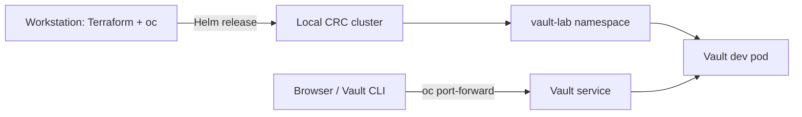

# OpenShift Stage 1 — Deploy Vault with Helm

This stage deploys the official HashiCorp Vault Helm chart to an OpenShift
cluster. Terraform manages the Helm release, so the chart version and values
are reviewable and repeatable.

This first deployment intentionally uses Vault's **development mode**. It is
only a short-lived introduction to Helm and the OpenShift integration. The
next stage replaces this dev-mode release with persistent integrated Raft
storage and TLS.

## Requirements

- For a free, local-only lab, install OpenShift Local (CRC) and start its
  cluster on your computer. A hosted/shared OpenShift cluster is optional and
  is not required by any course step.
- `oc`, Helm 3, Terraform 1.5 or later, and Git installed locally.
- Enough free memory, CPU, and disk space for the local cluster, Vault, and
  its persistent volume. CRC's published requirements vary by operating
  system and release; check them before installing.

No paid cloud account or hosted cluster is needed. CRC requires a free Red Hat
account. The course uses Vault Community Edition, which has no software
license fee for this learning lab but is distributed under the Business Source
License (BSL), not an OSI-approved open-source license; review its terms if
your intended use goes beyond personal learning. You will need an internet
connection to download CRC, container images, Helm chart content, and
Terraform providers; after downloads, the lab services run on your computer.
If you choose to use a hosted cluster instead, its provider may charge for
usage.

### macOS installation with Homebrew

Install the OpenShift CLI, Terraform, and Helm 3 with Homebrew. Helm 3 is
installed as an alternate-version, keg-only formula, so add it to the current
shell's `PATH`:

```sh
brew install openshift-cli
brew tap hashicorp/tap
brew install hashicorp/tap/terraform helm@3 openssl@3 git
export PATH="$(brew --prefix helm@3)/bin:$(brew --prefix openssl@3)/bin:$PATH"
```

OpenShift Local (CRC) does not have a Homebrew formula. Download the macOS
installer from the [Red Hat OpenShift Local page](https://console.redhat.com/openshift/create/local),
install it, and download the pull secret from that page. A free Red Hat
account is required. In a terminal, prepare and start CRC, providing the pull
secret when prompted:

```sh
crc setup
crc start
```

CRC prints the `oc login` command and credentials after startup. You can also
display them later with `crc console --credentials`. More info can be found here
[Red Hat Use CRC](https://crc.dev/docs/using/).

### Windows and Linux installation

- Install the [OpenShift CLI (`oc`)](https://docs.openshift.com/container-platform/latest/cli_reference/openshift_cli/getting-started-cli.html).
- Install [Helm](https://helm.sh/docs/intro/install/).
- Install [Terraform](https://developer.hashicorp.com/terraform/install).
- Install [OpenShift Local (CRC)](https://developers.redhat.com/products/openshift-local/overview) for a local cluster.

If you use CRC, start it first. Log in with the `oc login` command shown by
CRC and verify the local cluster and user:

```sh
oc login
oc whoami
oc whoami --show-server
oc project
helm version
terraform version
```

Terraform's Helm provider uses the kubeconfig at `~/.kube/config` and its
current context by default. Confirm the server shown by `oc whoami --show-server`
is the local CRC cluster before applying Terraform.

For CRC start/stop/reset guidance, common `oc` commands, the web console, and
an explanation of port-forwarding, see
[Local OpenShift workflow](./OPENSHIFT_LOCAL_WORKFLOW.md).

## Review the configuration

The Terraform configuration is in
[terraform/openshift/main.tf](./terraform/openshift/main.tf). It installs the
official `vault` chart version `0.34.1` into namespace `vault-lab`; OpenShift
compatibility is enabled in
[terraform/openshift/values-dev.yaml](./terraform/openshift/values-dev.yaml).
For this initial stage, explicitly select the dev profile and keep Stage 3
Kubernetes authentication resources disabled. Both settings are required
Terraform inputs; omitting either makes Terraform prompt rather than silently
changing or deleting resources.

Review the values before deployment. Development mode has no persistent
storage, uses a known root token, and disables TLS. Never put real secrets in
this Vault.



## Install Vault

From the repository root, initialize and validate the Terraform configuration:

```sh
terraform -chdir=terraform/openshift init
terraform -chdir=terraform/openshift fmt -check
terraform -chdir=terraform/openshift validate
terraform -chdir=terraform/openshift plan \
  -var='vault_profile=dev' \
  -var='enable_kubernetes_auth=false'
```

Review the plan. If it targets the wrong cluster or proposes unexpected
resources, stop and correct your kubeconfig/context before applying.

Apply the Helm release:

```sh
terraform -chdir=terraform/openshift apply \
  -var='vault_profile=dev' \
  -var='enable_kubernetes_auth=false'
```

After reviewing the plan, type `yes` when Terraform asks for confirmation.
Wait for the Helm release and Vault pod to become ready:

```sh
oc get pods -n vault-lab
helm -n vault-lab list
```

The pod should show `Running` and `1/1` ready.

## Reset the lab for a fresh Terraform deployment

Use this procedure to remove a lab from any stage and start again from Stage
1. It deletes all Vault data and the Stage 3 demo namespace. Confirm `oc` is
connected to your local CRC cluster before continuing:

```sh
oc whoami --show-server
```

Stop any Vault port-forward with **Ctrl+C**. Uninstall the Helm release if it
exists, then delete both course namespaces. This removes the Vault workload,
TLS Secret, and namespaced persistent volume claims:

```sh
helm uninstall vault -n vault-lab --ignore-not-found
oc delete namespace vault-apps vault-lab --ignore-not-found=true --wait=true --timeout=180s
```

Check for a persistent volume left behind by the cluster's storage reclaim
policy:

```sh
oc get pv -o custom-columns=NAME:.metadata.name,STATUS:.status.phase,CLAIM:.spec.claimRef.name,NAMESPACE:.spec.claimRef.namespace,RECLAIM:.spec.persistentVolumeReclaimPolicy
```

If a remaining PV's claim was `data-vault-0` in namespace `vault-lab`, and
you are certain its data can be discarded, delete that specific PV:

```sh
oc delete pv <persistent-volume-name>
```

After the namespaces and any lab PV are gone, move the local Terraform state
aside. State tracks the old deployment and can contain sensitive values:

```sh
umask 077
BACKUP_DIR="$HOME/.vault-openshift-lab/state-backups/$(date +%Y%m%d-%H%M%S)"
mkdir -p "$BACKUP_DIR"
for STATE_FILE in \
  terraform/openshift/terraform.tfstate \
  terraform/openshift/terraform.tfstate.backup; do
  if [ -f "$STATE_FILE" ]; then
    mv "$STATE_FILE" "$BACKUP_DIR/"
  fi
done
```

Keep the backup private and do not restore it for this fresh deployment. Keep
the `.terraform` provider cache and lock file; they are not deployment state.
Run `terraform -chdir=terraform/openshift init`, then use the Stage 1 plan and
apply commands above. The fresh plan should create the Helm release rather
than modify or destroy resources from the previous run. When you continue to
Stages 2 and 3, use the profile and auth settings in those guides.

## Connect to Vault

Open a new terminal and forward the Vault service port:

```sh
oc port-forward -n vault-lab service/vault 8200:8200
```

Keep port forwarding running. In another terminal, configure the CLI:

```sh
export VAULT_ADDR=http://127.0.0.1:8200
export VAULT_TOKEN=dev-only-token
vault status
vault secrets list
```

The Vault UI is available at <http://127.0.0.1:8200/ui>. Sign in with the same
development root token. Do not expose this port or token beyond your personal
lab.

## Reset Stage 1

Follow [Reset the lab](#reset-the-lab-for-a-fresh-terraform-deployment) to
remove the deployment and prepare a fresh Terraform run.

## Next stage

Continue with [OpenShift Stage 2 — Raft and TLS](./OPENSHIFT_VAULT_RAFT_TLS.md)
to replace the disposable dev server with persistent Vault storage and
encrypted client/server connections.
