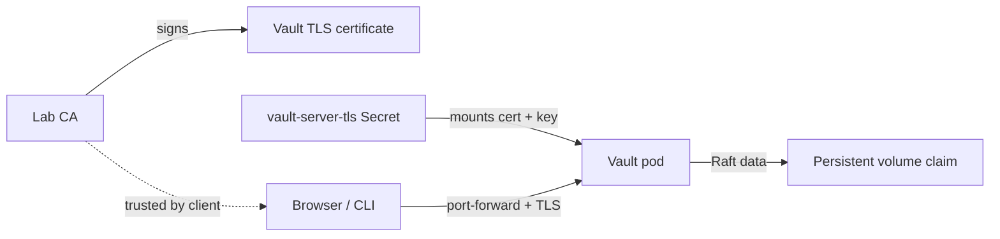

# OpenShift Stage 2 — Persistent Raft and TLS

In Stage 1, Vault ran in development mode: it had a fixed root token, no TLS,
and discarded all data when restarted. This stage replaces that Helm release
with a single-node Vault server using integrated Raft storage and TLS.

This is suitable for learning on OpenShift Local or a small cluster. A single
node has persistent storage but **is not highly available**. The TLS CA is
created for this lab and is not a production PKI design.

Complete [Stage 1](./OPENSHIFT_VAULT.md) first. If you followed its full reset
procedure, that deleted the namespace and release; rerun Stage 1 to create the
`vault-lab` namespace and dev-mode Helm release before continuing here. Stage
2 removes the dev-mode release and creates a new Raft/TLS release in that
namespace.

## 1. Create a TLS certificate for Vault

Vault's OpenShift Service is named `vault` in namespace `vault-lab`. The
certificate needs to cover that service name and the StatefulSet peer address.
Create the lab CA and Vault server certificate outside the repository:

```sh
TLS_DIR="$HOME/.vault-openshift-lab"
mkdir -p "$TLS_DIR"
chmod 700 "$TLS_DIR"

openssl req -x509 -newkey rsa:3072 -sha256 -nodes -days 365 \
  -keyout "$TLS_DIR/ca.key" \
  -out "$TLS_DIR/ca.crt" \
  -subj "/CN=Vault OpenShift Learning CA" \
  -addext "basicConstraints=critical,CA:TRUE" \
  -addext "keyUsage=critical,keyCertSign,cRLSign"

openssl req -new -newkey rsa:3072 -nodes \
  -keyout "$TLS_DIR/tls.key" \
  -out "$TLS_DIR/tls.csr" \
  -subj "/CN=vault.vault-lab.svc" \
  -addext "subjectAltName=DNS:vault,DNS:vault.vault-lab,DNS:vault.vault-lab.svc,DNS:vault.vault-lab.svc.cluster.local,DNS:vault-0.vault-internal,DNS:vault-0.vault-internal.vault-lab.svc,DNS:vault-0.vault-internal.vault-lab.svc.cluster.local"

openssl x509 -req -sha256 -days 365 \
  -in "$TLS_DIR/tls.csr" \
  -CA "$TLS_DIR/ca.crt" \
  -CAkey "$TLS_DIR/ca.key" \
  -CAcreateserial \
  -copy_extensions copy \
  -out "$TLS_DIR/tls.crt"

chmod 600 "$TLS_DIR/ca.key" "$TLS_DIR/tls.key"
```

The certificate includes the service DNS names used by the API and the
StatefulSet address used for Raft cluster traffic. The CA private key remains
on your workstation and is not uploaded to Vault. The Vault server private
key is placed in an OpenShift Secret in the next step; do not commit or share
either key.



Check the certificate and its SANs before installing it:

```sh
openssl verify -CAfile "$TLS_DIR/ca.crt" "$TLS_DIR/tls.crt"
openssl x509 -in "$TLS_DIR/tls.crt" -noout -subject -issuer -ext subjectAltName
```

The verify command should report `OK`.

## 2. Store the server key and certificate in OpenShift

The Helm values mount a Secret named `vault-server-tls` into each Vault pod.
Create or update it in the existing namespace:

```sh
oc create secret generic vault-server-tls \
  --namespace vault-lab \
  --from-file=tls.crt="$TLS_DIR/tls.crt" \
  --from-file=tls.key="$TLS_DIR/tls.key" \
  --from-file=ca.crt="$TLS_DIR/ca.crt" \
  --dry-run=client -o yaml | oc apply -f -
```

The Secret contains the server private key, so restrict access to the
namespace and do not print or commit its contents.

## 3. Replace the dev release with Raft and TLS

Terraform now reads
[values-raft-tls.yaml](./terraform/openshift/values-raft-tls.yaml). It enables
integrated Raft storage, a persistent volume claim, TLS on Vault's listener,
and the previously created TLS Secret. It disables the development server.

The dev-mode and Raft configurations require incompatible StatefulSet
specifications, so Kubernetes cannot update the existing StatefulSet in place.
The dev server stores data only in memory, so replacing its Helm release does
not discard persistent Vault data. Keep the `vault-lab` namespace and
`vault-server-tls` Secret, but uninstall the dev release and remove its
Terraform state entry:

```sh
helm uninstall vault -n vault-lab
terraform -chdir=terraform/openshift state rm helm_release.vault
```

`helm uninstall` removes the Stage 1 Vault resources; `terraform state rm`
only removes Terraform's tracking record and does not delete cluster resources.

From the repository root, plan and apply the new release:

```sh
terraform -chdir=terraform/openshift fmt -check
terraform -chdir=terraform/openshift validate
terraform -chdir=terraform/openshift plan \
  -var='vault_profile=raft-tls' \
  -var='enable_kubernetes_auth=false'
```

Review the plan to confirm it will create the `vault` release in the existing
`vault-lab` namespace. The new server starts uninitialized; Stage 1's
development data is not carried over.

```sh
terraform -chdir=terraform/openshift apply \
  -var='vault_profile=raft-tls' \
  -var='enable_kubernetes_auth=false'
```

Wait for the Vault pod to be `Running` and confirm the persistent volume
claim is bound:

```sh
oc get pods,pvc -n vault-lab
```

The pod can show `0/1 Ready` at this point. That is expected: the readiness
probe reports Vault as not ready while it is sealed and uninitialized.
`oc exec` can still run commands in a running, not-yet-ready pod.

## 4. Initialize and unseal Vault

For a one-node lab, initialize with one unseal key and a threshold of one:

```sh
oc exec -it -n vault-lab vault-0 -- env \
  VAULT_ADDR=https://vault-0.vault-internal.vault-lab.svc:8200 \
  VAULT_CACERT=/vault/userconfig/vault-tls/ca.crt \
  vault operator init -key-shares=1 -key-threshold=1
```

Run `operator init` only once for this data directory. Its output contains
the unseal key and initial root token. Do not rerun it if Vault has already
been initialized.

Save the unseal key and initial root token in a secure local password manager.
They are credentials; do not save them in the repository, a shell script, or
Terraform state. This one-key threshold is for a disposable learning cluster,
not a production key-management strategy.

Unseal the server. The command prompts for the unseal key without placing it
in shell history:

```sh
oc exec -it -n vault-lab vault-0 -- env \
  VAULT_ADDR=https://vault-0.vault-internal.vault-lab.svc:8200 \
  VAULT_CACERT=/vault/userconfig/vault-tls/ca.crt \
  vault operator unseal
```

Check status:

```sh
oc exec -n vault-lab vault-0 -- env \
  VAULT_ADDR=https://vault-0.vault-internal.vault-lab.svc:8200 \
  VAULT_CACERT=/vault/userconfig/vault-tls/ca.crt \
  vault status
```

After unsealing, wait for the readiness probe to succeed:

```sh
oc get pods -n vault-lab --watch
```

Continue when `vault-0` shows `1/1 Ready` (press **Ctrl+C** to stop watching).

With one server, the Raft peer list should contain `vault-0`. Query it by
providing the initial root token at a hidden prompt:

```sh
printf "Vault root token: "
IFS= read -r -s VAULT_TOKEN
printf '\n'
oc exec -n vault-lab vault-0 -- env \
  VAULT_ADDR=https://vault-0.vault-internal.vault-lab.svc:8200 \
  VAULT_CACERT=/vault/userconfig/vault-tls/ca.crt \
  VAULT_TOKEN="$VAULT_TOKEN" \
  vault operator raft list-peers
unset VAULT_TOKEN
```

Vault is configured with manual Shamir unsealing, not auto-unseal. Its data
survives a pod restart on the PVC, but Vault starts sealed after that restart.
Do not run `vault operator init` again. Instead, unseal the existing Vault with
the saved unseal key:

```sh
oc exec -it -n vault-lab vault-0 -- env \
  VAULT_ADDR=https://vault-0.vault-internal.vault-lab.svc:8200 \
  VAULT_CACERT=/vault/userconfig/vault-tls/ca.crt \
  vault operator unseal
```

Once Vault reports unsealed, its existing secrets and configuration should be
available again.

## 5. Connect from your workstation over TLS

Forward the service port in a terminal and leave the command running:

```sh
oc port-forward -n vault-lab service/vault 8200:8200
```

In another terminal, trust the lab CA and set the TLS server name. The
port-forward uses `127.0.0.1`, but the certificate is issued for the Vault
Service DNS name:

```sh
export VAULT_ADDR=https://127.0.0.1:8200
export VAULT_CACERT="$HOME/.vault-openshift-lab/ca.crt"
export VAULT_TLS_SERVER_NAME=vault.vault-lab.svc
export VAULT_TOKEN="<initial-root-token>"
vault status
vault secrets list
```

Replace the placeholder with the initial root token. The status should report
that Vault is initialized and unsealed. Do not disable TLS verification to
work around certificate errors; verify the CA path and server name instead.

### Open the Vault UI in Firefox

Keep the port-forward running. The certificate is for
`vault.vault-lab.svc`, not `127.0.0.1`, so use the certificate's DNS name in
Firefox. Add a local hosts entry by editing `/etc/hosts`:

```sh
sudo nano /etc/hosts
```

Add this line, then save the file and exit:

```text
127.0.0.1 vault.vault-lab.svc
```

In Firefox, open **Settings → Privacy & Security → Certificates → View
Certificates → Authorities → Import** and select
`$HOME/.vault-openshift-lab/ca.crt`. Enable the option to trust this CA to
identify websites. Import only the public `ca.crt`; never import or share
`ca.key` or `tls.key`.

Open <https://vault.vault-lab.svc:8200/ui> and sign in with the initial root
token saved from `vault operator init` in Stage 2. The Stage 1
`dev-only-token` does not work with this newly initialized Vault. Do not use
`https://127.0.0.1:8200` in Firefox, because the certificate does not contain
that IP address.

When finished with the lab, remove the `127.0.0.1 vault.vault-lab.svc` line
from `/etc/hosts` and remove the lab CA from Firefox's Authorities list if you
no longer need to trust it.

## Scaling beyond a single lab node

The default is one Vault pod because OpenShift Local often has limited
resources. A three-node Raft cluster tolerates a server failure and is a more
realistic HA exercise, but requires capacity for three Vault pods and three
persistent volumes. Before scaling, issue a certificate with SANs for every
Vault pod's stable DNS name, set `server.ha.replicas` to `3`, and follow Vault's
Raft join and unseal procedure for each pod. Do not simply increase replicas
without configuring and verifying the peer addresses and TLS names.

For production, use a managed organizational CA, a proper key-management and
auto-unseal design, backups, audit devices, resource requests, and a supported
multi-node topology. This chapter is not a production deployment recipe.

Continue to [Stage 3 — Kubernetes authentication](./OPENSHIFT_KUBERNETES_AUTH.md)
to bind Vault policies to OpenShift ServiceAccounts.

## Reset the lab

When you are ready to remove the deployment and its data, follow
[Stage 1's reset procedure](./OPENSHIFT_VAULT.md#reset-the-lab-for-a-fresh-terraform-deployment).
Keep `"$HOME/.vault-openshift-lab"` if you want to reuse the lab CA files.
