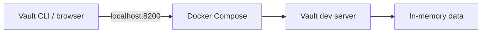

# Prerequisites

This project is a hands-on introduction to HashiCorp Vault. You will run a
temporary Vault development server in Docker and control it from your computer
with the Vault command-line interface (CLI). Terraform is only needed for the
optional [Terraform chapter](./VAULT_TERRAFORM.md).

You do not need a cloud account, a production Vault server, or a programming
language for these labs.

The basic Docker/Vault labs can run locally without a hosted service. Docker
Desktop is free for personal learning; organizations may be subject to
Docker's licensing terms. The OpenShift chapters additionally use OpenShift
Local (CRC), which runs a local cluster and requires a free Red Hat account.
Neither path requires a paid cloud account, though your computer needs enough
resources and downloads require an internet connection.

## What you need

1. **Docker**, installed and running. Docker runs the Vault server in a
   container. You will use Docker Compose v2 (`docker compose`) to start it.
2. **Vault CLI**, installed on your computer. The CLI sends commands to the
   server running in Docker; it is a separate program.
3. **A terminal** that supports Bash or a similar shell. Terminal is built into
   macOS and Linux. On Windows, use Ubuntu in WSL.
4. **This project’s files**, including the learning chapters and the
   `policies/` folder.
   You can get them by installing Git and cloning the project, or by
   downloading the project as a ZIP file.

## 1. Install and start Docker

### macOS

If you do not already have Homebrew, install it using the instructions at
[brew.sh](https://brew.sh/). Then install Docker Desktop:

```sh
brew install --cask docker-desktop
```

Open Docker from Applications and wait until it reports that Docker is
running.

### Windows and Linux

- **Windows:** install [Docker Desktop](https://docs.docker.com/get-started/get-docker/).
  Docker Desktop uses WSL 2 for Linux containers. If prompted, follow the
  [WSL installation instructions](https://learn.microsoft.com/windows/wsl/install).
  Use an Ubuntu terminal (WSL) for the commands in this project.
- **Linux:** install Docker Engine by following the [Docker Engine
  installation instructions](https://docs.docker.com/engine/install/) for your
  distribution, including the Compose plugin.

Open a terminal and check that Docker is available:

```sh
docker --version
docker compose version
docker info
```

The version commands should print version numbers. `docker info` should print
Docker system information. If it reports that it cannot connect to the Docker
daemon, start Docker Desktop or Docker Engine and try again.

## 2. Install the Vault CLI

Install the CLI on your computer, not inside the Docker container. On macOS,
install it with Homebrew:

```sh
brew tap hashicorp/tap
brew install hashicorp/tap/vault
```

On Windows, install the CLI in your Ubuntu/WSL environment if that is where
you will run the labs. On Linux or Windows outside WSL, follow HashiCorp's
[Vault installation instructions](https://developer.hashicorp.com/vault/install).

Verify the CLI is installed:

```sh
vault version
```

You should see a Vault version number. If your terminal says that `vault` is
not found, finish the installation or reopen the terminal so it can find the
new command.

## 3. Get the project files

Install Git with Homebrew on macOS if it is not already available:

```sh
brew install git
```

On other platforms, install Git using the instructions at
[git-scm.com](https://git-scm.com/downloads). Then clone the project and move
into its folder:

```sh
git clone https://github.com/IsakMovitz/hashicorp-vault-learning.git
cd hashicorp-vault-learning
```

Check that the guide and policy files are present:

```sh
ls
ls policies
```

Alternatively, download the project as a ZIP from
[GitHub](https://github.com/IsakMovitz/hashicorp-vault-learning), extract it,
and open a terminal in the extracted folder. Git is only needed if you want to
clone or update the project from the command line.

## 4. Start the local Vault development server

From the project folder, start Vault with Docker Compose:

```sh
docker compose up
```

The first run may take a while as Docker downloads the pinned Vault image.
Compose keeps this terminal occupied and shows the server logs. Open a
**second terminal** for Vault CLI commands. The configuration is in
[compose.yaml](./compose.yaml), so learners can see the image, command, and
port mapping rather than having to remember a long `docker run` command.

This runs Vault in **development mode** for local learning only. The
configuration uses a known root token, stores data only in memory, and binds
the service to your computer's loopback interface. Do not use this setup or
token for real secrets or production systems. Data created in Vault is lost
when the server stops.



To stop Vault, press **Ctrl+C** in the terminal running Compose. Then, from
the project folder, remove the stopped container:

```sh
docker compose down
```

Closing the terminal window alone may leave the container running. If that
happens, open another terminal, change to the project folder, and run
`docker compose down`.

To start from a clean Vault state, run `docker compose up` again after stopping
and removing the previous container.

## 5. Connect the CLI to Vault

In the second terminal, set the address and development token:

```sh
export VAULT_ADDR=http://127.0.0.1:8200
export VAULT_TOKEN=dev-only-token
```

These commands work in Bash and Zsh, including Ubuntu on WSL. If you close this
terminal, open another one and run the two `export` commands again.

Check the connection:

```sh
vault status
```

Vault should report that it is initialized and unsealed. In development mode,
Vault initializes and unseals itself when it starts.

You are ready to follow [VAULT_FUNDAMENTALS.md](./VAULT_FUNDAMENTALS.md). Start with its first lab and
keep the Docker server running in the other terminal.

## Troubleshooting

- **`docker: command not found`:** install Docker, then reopen your terminal.
- **Cannot connect to the Docker daemon:** start Docker Desktop or Docker
  Engine, then retry `docker info`.
- **`vault: command not found`:** complete the Vault CLI installation, reopen
  your terminal, and retry `vault version`.
- **Vault CLI cannot connect:** check that the Docker server is still running
  and that `VAULT_ADDR` is set to `http://127.0.0.1:8200`.
- **Port 8200 is already in use:** stop the other service using that port before
  starting this lab server. If a previous Compose container is stopped, run
  `docker compose down` from the project folder.
- **Policy file not found:** run the policy commands from the project folder,
  so paths such as `policies/myapp-read.hcl` resolve correctly.
