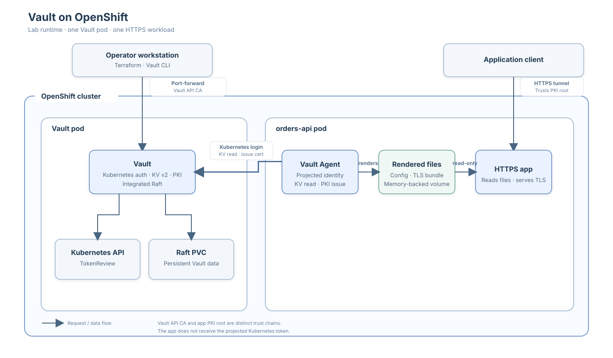
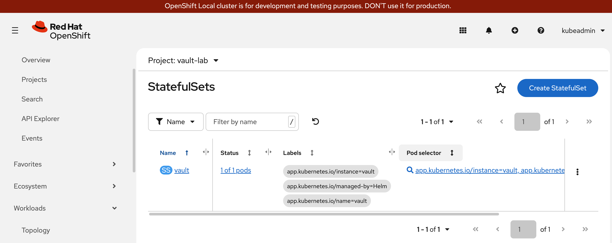

# HashiCorp Vault on OpenShift

A learning lab for a single-node Vault deployment on OpenShift Local (CRC) or
another OpenShift cluster. It demonstrates integrated Raft storage, TLS,
Kubernetes workload identity, Vault PKI, and an HTTPS demo application. Only
`orders-api` runs as an app; `payments-api` is used in authorization tests.

**OpenShift Local console**

## Follow the lab

1. [Prepare the workstation and cluster](./PREREQUISITES.md).
2. [Deploy Vault and configure Kubernetes authentication](./OPENSHIFT_KUBERNETES_AUTH.md).
3. [Deploy the HTTPS app, configure Vault PKI, and test certificate
   rotation](./HTTPS_WORKLOAD_AND_PKI.md).
4. [Use CRC, the OpenShift console, port-forwarding, and the Vault
   UI](./OPENSHIFT_LOCAL_WORKFLOW.md).

Before adapting the lab for real workloads, read
[Lab security and production considerations](./LAB_SECURITY_AND_PRODUCTION.md).
This is a disposable learning setup, not a production deployment. Keep private
keys, the unseal key, root token, and Terraform state private. Never use real
application credentials in the demo KV values.
