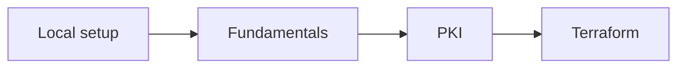

# HashiCorp Vault Learning Lab

A guided, local introduction to HashiCorp Vault. Work through the chapters in
order: start with KV and policies, learn PKI, then recreate Vault configuration
with Terraform.

## Course chapters

1. [Prerequisites and local setup](./PREREQUISITES.md) — install Docker and the
   Vault CLI, start the Compose-managed development server, and connect to it.
2. [Vault fundamentals](./VAULT_FUNDAMENTALS.md) — explore the Vault UI and
   CLI, store KV secrets, apply policies, test tokens, and configure AppRole.
3. [Vault PKI](./VAULT_PKI.md) — configure a root and intermediate CA, issue
   certificates, inspect them with OpenSSL, and explore certificate lifecycle.
4. [Terraform with Vault](./VAULT_TERRAFORM.md) — manage KV, policies, PKI,
   and AppRole configuration as code.

## Suggested workflow

Complete the fundamentals and PKI chapters manually first. Then start with a
fresh local Vault development server and follow the Terraform chapter to
recreate a small lab declaratively.

> **Local learning only:** the development server uses temporary storage and a
> well-known root token. Never use the example token, generated test secrets,
> or local Terraform state for real systems or credentials.

The `policies/` folder contains policy examples used in the fundamentals
chapter.
