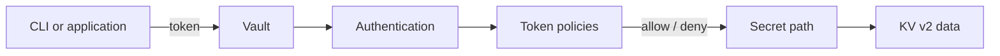

# Vault Fundamentals

This lab builds up one idea at a time: Vault authenticates a client, checks its
policies, and allows or denies actions on secret paths.



Use the local development server described in
[PREREQUISITES.md](./PREREQUISITES.md). Keep it running in one terminal. Run
the commands below from the project directory in another terminal.

The development server uses temporary storage and a well-known root token. It
is for learning only; never use it or its token for real secrets.

## 1. Connect and explore

Set the address and development token in your CLI terminal:

```sh
export VAULT_ADDR=http://127.0.0.1:8200
export VAULT_TOKEN=dev-only-token
vault status
```

Vault should report that it is initialized and unsealed.

You can also open the local [Vault UI](http://127.0.0.1:8200/ui) in a browser or as a tab in your editor.
Choose **Token** authentication and sign in with `dev-only-token`. The UI and
CLI show the same Vault. Use the UI to browse **Secrets Engines**, the `secret/`
KV engine, and policies. The root token can do anything, so sign out and use a
restricted token when checking what a less-privileged client can access.

List the mounted engines:

```sh
vault secrets list
```

In the development server, `secret/` is normally a KV v2 engine. A *secrets
engine* stores, generates, or manages data; a *mount* is its path in Vault.

## 2. Store and read a KV secret

Create a secret for the lab:

```sh
vault kv put secret/myapp username=alice password=example-password
```

Read it and then read just one field:

```sh
vault kv get secret/myapp
vault kv get -field=username secret/myapp
```

`secret/myapp` is the logical path used by the KV CLI, not a file on your
computer. KV v2 stores secret data and version metadata separately. For
example, the underlying API paths are `secret/data/myapp` and
`secret/metadata/myapp`. This distinction matters when writing policies.

## 3. Restrict access with policies and tokens

A **policy** defines actions on Vault paths. The project includes a read-only
policy at [policies/myapp-read.hcl](./policies/myapp-read.hcl):

```hcl
path "secret/data/myapp" {
  capabilities = ["read"]
}
```

Load it into Vault and inspect the loaded policy:

```sh
vault policy write myapp-read policies/myapp-read.hcl
vault policy read myapp-read
```

Create a token that carries the policy:

```sh
vault token create -policy=myapp-read
```

Copy the token value from the output. Test it in a separate terminal so you
can keep your root-token terminal available; replace the quoted placeholder
with the token Vault returned:

```sh
export VAULT_TOKEN="paste-the-created-token-here"
vault token lookup
vault kv get secret/myapp
vault kv get secret/anotherapp
```

The first read should succeed and the second should be denied. The token
identifies the caller; the attached policy authorizes the read of
`secret/data/myapp`. A token without permission cannot read every path just
because it can authenticate.

In the restricted-token terminal, restore the development token if you need to
administer Vault there:

```sh
export VAULT_TOKEN=dev-only-token
```

### Compare with the read-and-update policy

The project also includes
[policies/myapp-read-update.hcl](./policies/myapp-read-update.hcl):

```hcl
path "secret/data/myapp" {
  capabilities = ["read", "update"]
}
```

Load it and create a token with it:

```sh
vault policy write myapp-read-update policies/myapp-read-update.hcl
vault token create -policy=myapp-read-update
```

`update` allows changing an existing secret; it does not grant `create`,
`delete`, or access to other paths. KV v2 `put` needs `create` for a new secret
and `update` for an existing secret.

## 4. Scope a policy to a group of paths

The policy [policies/myapp-dev-read.hcl](./policies/myapp-dev-read.hcl) allows
reads beneath `secret/dev/`:

```hcl
path "secret/data/dev/*" {
  capabilities = ["read"]
}
```

Load the policy and create sample secrets using the root token:

```sh
vault policy write myapp-dev-read policies/myapp-dev-read.hcl
vault kv put secret/dev/app username=devuser password=dev-password
vault kv put secret/dev/database username=dbuser password=db-password
vault kv put secret/prod/app username=produser password=prod-password
```

Create a token with `myapp-dev-read`:

```sh
vault token create -policy=myapp-dev-read
```

Copy the token from the output, then use it in a separate terminal (replace
the quoted placeholder):

```sh
export VAULT_TOKEN="paste-the-created-token-here"
vault kv get secret/dev/app
vault kv get secret/dev/database
vault kv get secret/prod/app
```

The development paths should be readable; the production path should be
denied. The wildcard in the policy applies to the KV v2 **data** path. Listing
secret names uses the **metadata** path and requires a separate `list`
capability, which this read-only example intentionally does not grant.

## 5. Use AppRole for an application identity

Tokens are credentials that clients use to make Vault requests. AppRole is an
authentication method intended for applications and machines: an application
proves its identity using a **Role ID** and a **Secret ID**, and Vault returns a
short-lived token. Policies attached to the AppRole are attached to that token.

```text
Role ID + Secret ID
        │ authenticate
        ▼
      AppRole ── issues ──> Vault token ── carries ──> Policy
                                                      │
                                                      ▼
                                           permitted secret paths
```

The Role ID identifies the role and is not treated as a password. The Secret
ID is a credential: protect it, and do not commit it to source control. In a
real deployment, applications should receive these credentials through a
secure provisioning mechanism, not from a human's root token.

### Configure the AppRole

Run these commands in the root-token terminal. The policy must already exist;
the `myapp-read` policy created earlier grants this role access only to
`secret/myapp`.

```sh
vault auth enable approle
vault write auth/approle/role/myapp \
  token_policies="myapp-read" \
  token_ttl="1h" \
  token_max_ttl="4h" \
  bind_secret_id=true
```

Get the Role ID and create a Secret ID:

```sh
vault read -field=role_id auth/approle/role/myapp/role-id
vault write -f auth/approle/role/myapp/secret-id
```

The second command returns a Secret ID. For this local exercise, copy both
values temporarily. Do not publish them or put them in a committed file.

### Log in as the application

In a separate terminal, enter the Role ID and Secret ID you just received.
The Secret ID is read without echoing it or adding it to shell history:

```sh
export VAULT_ADDR=http://127.0.0.1:8200
printf "Role ID: "
read -r ROLE_ID
printf "Secret ID: "
read -r -s SECRET_ID
printf '\n'
```

Set `VAULT_ADDR` in this terminal too: environment variables do not carry over
from another terminal. Use the HTTP URL for the local development server; the
Vault CLI otherwise defaults to HTTPS.

Exchange them for an AppRole token:

```sh
APP_TOKEN=$(vault write -field=token auth/approle/login \
  role_id="$ROLE_ID" \
  secret_id="$SECRET_ID")
```

Use that token to inspect its policy and read the permitted secret:

```sh
VAULT_TOKEN="$APP_TOKEN" vault token lookup
VAULT_TOKEN="$APP_TOKEN" vault kv get secret/myapp
VAULT_TOKEN="$APP_TOKEN" vault kv get secret/anotherapp
```

The `myapp` read should succeed and the `anotherapp` read should be denied.
This demonstrates the full flow: AppRole authenticates the application and
issues a token; the token's policy determines what it can do.

For real applications, do not hard-code the Secret ID or put it in shell
history, logs, source control, or a container image. This lab uses a
development server and credentials manually for clarity.

## 6. Explore KV versions and deletion

On a fresh development server, the initial write in Lab 2 created version 1.
Write another version and read both:

```sh
vault kv put secret/myapp username=alice password=version-two
vault kv get secret/myapp
vault kv get -version=1 secret/myapp
vault kv get -version=2 secret/myapp
```

If you have repeated the labs, use `vault kv metadata get secret/myapp` to
check the actual version numbers.

KV v2 keeps previous versions. A normal delete hides the latest version but
does not immediately destroy its data:

```sh
vault kv delete secret/myapp
vault kv metadata get secret/myapp
vault kv undelete -versions=2 secret/myapp
vault kv get secret/myapp
```

Undelete restores a soft-deleted version. Destroying a version is permanent;
avoid destructive commands until you understand their effect.

## Key ideas

- **Authentication:** who is the caller? Examples include a token and AppRole.
- **Authorization:** what can that caller do? Policies grant capabilities such
  as `read` or `update` on specific paths.
- **Engine and path:** where is the data? Here, KV v2 is mounted at `secret/`.
- **Secret:** what data is stored there? For example, fields under
  `secret/myapp`.

Suggested sequence: explore Vault, store/read a secret, create a policy and
token, test path restrictions, authenticate with AppRole, then experiment with
KV versioning.
