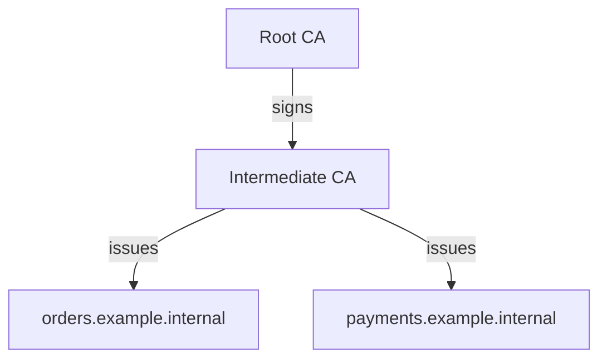

# Vault PKI

This lab introduces Vault's PKI secrets engine, which acts as a certificate
authority (CA). You will enable PKI, create a root CA, issue and inspect a
certificate, and then build a root-to-intermediate CA chain.

Follow the steps against a local Vault development server as described in
[PREREQUISITES.md](./PREREQUISITES.md). This setup is for learning only: it
uses a known root token and temporary storage, and must not be used for real
services or production certificates.

## Before you start

Keep the Vault development server running. In the terminal where you run Vault
commands, make sure the CLI is connected as the development root token:

```sh
export VAULT_ADDR=http://127.0.0.1:8200
export VAULT_TOKEN=dev-only-token
vault status
```

You should see that Vault is initialized and unsealed.

This lab uses **OpenSSL** to inspect and verify certificates, and **jq** to
extract fields from Vault's JSON responses without printing private keys.
Check whether they are installed:

```sh
openssl version
jq --version
```

On macOS, install both tools with Homebrew. The Homebrew OpenSSL 3 formula is
keg-only, so add its binary directory to the current shell's `PATH`:

```sh
brew install openssl@3 jq
export PATH="$(brew --prefix openssl@3)/bin:$PATH"
```

On Ubuntu or Debian (including Ubuntu on WSL), install both with:

```sh
sudo apt-get update
sudo apt-get install openssl jq
```

If you use another Linux distribution, install OpenSSL and jq with its package
manager.

## Make a safe workspace for generated files

Certificate files and JSON responses can contain private keys. Keep them
outside the project directory and do not commit or share them.

```sh
mkdir -p ~/vault-pki-lab
cd ~/vault-pki-lab
```

## Part 1 — Enable PKI and create a root CA

Vault stores generated private keys inside its PKI secrets engine when you use
the `internal` key type. The root certificate itself is public, so save it for
later verification:

```sh
vault secrets enable -path=pki pki
vault secrets tune -max-lease-ttl=87600h pki
vault write -field=certificate pki/root/generate/internal \
  common_name="Vault PKI Lab Root CA" \
  ttl=87600h \
  key_type="rsa" \
  key_bits=2048 > root-ca.crt
```

The mount is named `pki/`. Its maximum TTL has been raised so it can contain a
10-year lab root CA; individual certificates issued below will have much
shorter lifetimes. If `vault secrets enable` says that `pki/` is already
mounted, do not enable it again. Check `vault secrets list`; only continue if
this mount is an unused PKI engine. Generating a root CA is a one-time operation
for that mount.

Confirm that the saved certificate is a CA and inspect its subject and
validity dates:

```sh
openssl x509 -in root-ca.crt -noout -subject -issuer -dates
```

The subject and issuer should be the same for this self-signed root.

## Part 2 — Create a role and issue a certificate

A PKI role is a set of rules for certificate requests: which names are allowed,
how long certificates last, and whether certificates are for TLS servers or
clients.

Create a role that allows subdomains of `example.internal` and issues
short-lived server certificates:

```sh
vault write pki/roles/my-role \
  allowed_domains="example.internal" \
  allow_subdomains=true \
  allow_bare_domains=false \
  max_ttl="72h" \
  key_type="rsa" \
  key_bits=2048 \
  server_flag=true \
  client_flag=false
```

Issue a certificate for `app.example.internal`, with
`api.example.internal` as an additional Subject Alternative Name (SAN):

```sh
vault write -format=json pki/issue/my-role \
  common_name="app.example.internal" \
  alt_names="api.example.internal" \
  ttl="24h" > app.json
chmod 600 app.json
```

The JSON file includes the issued private key. Extract the certificate and key
into separate files and keep the key private:

```sh
jq -r '.data.certificate' app.json > app.crt
jq -r '.data.private_key' app.json > app.key
chmod 600 app.key
```

The response also includes the issuing CA, the CA chain, and a serial number.
Inspect the certificate:

```sh
openssl x509 -in app.crt -noout -text
```

Look for its issuer, validity period, Subject Alternative Names, and
Extended Key Usage. Verify it against the root CA:

```sh
openssl verify -CAfile root-ca.crt app.crt
```

The expected result is `app.crt: OK`.

## Part 3 — Build a root-to-intermediate CA chain

In a larger setup, the root CA is kept offline or tightly controlled and signs
an intermediate CA. The intermediate CA then issues application certificates:



For this lab, the root is still running in the same development Vault. The
intermediate CA's private key will be generated and stored inside a second PKI
mount, `pki_int/`.

### 1. Create the intermediate mount and generate a CSR

A Certificate Signing Request (CSR) contains the intermediate CA's public key
and requested identity. The root CA will sign it in the next step.

```sh
vault secrets enable -path=pki_int pki
vault secrets tune -max-lease-ttl=43800h pki_int
vault write -format=json pki_int/intermediate/generate/internal \
  common_name="Vault PKI Lab Intermediate CA" \
  key_type="rsa" \
  key_bits=2048 > intermediate-request.json
chmod 600 intermediate-request.json
jq -r '.data.csr' intermediate-request.json > intermediate.csr
```

The intermediate private key stays in Vault; the CSR is safe to send to the
root for signing.

### 2. Sign the CSR with the root CA

Ask the root to sign the intermediate CSR. The resulting intermediate
certificate is valid for five years in this lab:

```sh
vault write -format=json pki/root/sign-intermediate \
  csr=@intermediate.csr \
  format=pem_bundle \
  ttl=43800h > intermediate-signed.json
jq -r '.data.certificate' intermediate-signed.json > intermediate-ca.crt
```

Install the signed certificate on the intermediate mount and configure the
imported issuer as the mount's default. PKI mounts can contain multiple
issuers, so setting the default explicitly ensures role-based issuance knows
which CA to use:

```sh
vault write -format=json pki_int/intermediate/set-signed \
  certificate=@intermediate-ca.crt > intermediate-install.json
chmod 600 intermediate-install.json
issuer_id="$(jq -er '.data.imported_issuers[0]' intermediate-install.json)"
vault write pki_int/config/issuers default="$issuer_id"
```

Confirm that the default is set before continuing:

```sh
vault read pki_int/config/issuers
```

The intermediate mount can now issue certificates under the chain rooted at
`pki/`.

If you already installed the intermediate certificate and issuance fails with
`no default issuer currently configured`, do not repeat the CSR or signing
steps. List the issuers on the mount, then set the issuer corresponding to
`Vault PKI Lab Intermediate CA` as the default:

```sh
vault list pki_int/issuers
vault write pki_int/config/issuers default="<issuer-id-from-the-list>"
vault read pki_int/config/issuers
```

### 3. Create a role on the intermediate and issue two certificates

```sh
vault write pki_int/roles/internal-services \
  allowed_domains="example.internal" \
  allow_subdomains=true \
  allow_bare_domains=false \
  max_ttl="72h" \
  key_type="rsa" \
  key_bits=2048 \
  server_flag=true \
  client_flag=false
```

Issue one certificate for each service. Each response contains a private key,
so write it to a restricted file and extract the certificate and key:

```sh
vault write -format=json pki_int/issue/internal-services \
  common_name="orders.example.internal" \
  ttl="24h" > orders.json
chmod 600 orders.json
jq -r '.data.certificate' orders.json > orders.crt
jq -r '.data.private_key' orders.json > orders.key
chmod 600 orders.key

vault write -format=json pki_int/issue/internal-services \
  common_name="payments.example.internal" \
  ttl="24h" > payments.json
chmod 600 payments.json
jq -r '.data.certificate' payments.json > payments.crt
jq -r '.data.private_key' payments.json > payments.key
chmod 600 payments.key
```

### How the generated files fit together

Think of a certificate as an identity card, and its matching private key as
proof that its holder owns that identity. The CA certificates let clients
check who issued the identity card:

```text
root-ca.crt                    trust anchor clients start from
└── intermediate-ca.crt        signed by the root; issues service certificates
    ├── orders.crt + orders.key
    └── payments.crt + payments.key
```

The files from the earlier `app` example are a separate, simpler path:
`app.crt` was issued directly by the root CA, not by the intermediate.

| File(s) | What they are for |
| --- | --- |
| `root-ca.crt` | Public root certificate. A client uses it as a trust anchor when verifying certificates in this lab. |
| `intermediate.csr` | Request containing the intermediate CA's public key and requested identity. The root signs this to create the intermediate certificate. |
| `intermediate-ca.crt` | The intermediate CA's public certificate, signed by the root. It links service certificates back to the root. |
| `app.crt`, `orders.crt`, `payments.crt` | Public certificates for services. `app.crt` was issued by the root; `orders.crt` and `payments.crt` were issued by the intermediate. |
| `app.key`, `orders.key`, `payments.key` | Private keys matching their service certificates. A service needs its own certificate and matching key to prove its identity. Keep these private. |
| `intermediate-request.json` | Vault's response when generating the intermediate CSR; `jq` extracts `intermediate.csr` from it. The intermediate private key stays inside Vault. |
| `intermediate-signed.json` | Vault's response when the root signs the CSR; `jq` extracts `intermediate-ca.crt` from it. |
| `intermediate-install.json` | Metadata returned when installing the signed intermediate, including the issuer ID used to set the default issuer. |
| `app.json`, `orders.json`, `payments.json` | Full issuance responses. They include the issued certificate and private key, which is why the guide restricts their permissions. The `.crt` and `.key` files are extracted from them. |

In a real TLS connection, the service presents its leaf certificate and
usually the intermediate certificate; the client already trusts the root
certificate. The service never sends its private key, and the root and
intermediate CA private keys remain in Vault in this lab. For example, verify
an intermediate-issued service certificate by trusting the root and supplying
the intermediate as the link in the chain:

```sh
openssl verify -CAfile root-ca.crt \
  -untrusted intermediate-ca.crt orders.crt
```

Keep the `.key` files and issuance `.json` files private. Deleting an issuance
JSON after safely extracting its certificate and key is optional; it does not
revoke the certificate.

Inspect a leaf certificate and verify the chain through the intermediate to
the root:

```sh
openssl x509 -in orders.crt -noout -text
openssl verify -CAfile root-ca.crt \
  -untrusted intermediate-ca.crt orders.crt
```

The expected verification result is `orders.crt: OK`. Repeat the commands with
`payments.crt` to inspect the other service certificate.

## Explore certificate lifecycle and role settings

Use the role and issuance commands above as a starting point for experiments:

- **TTL:** issue with `ttl="1h"` or `ttl="48h"` and inspect `Not Before` and
  `Not After` with OpenSSL. A requested TTL cannot exceed the role or mount
  maximum.
- **SANs:** issue a certificate with `alt_names="orders.example.internal,api.example.internal"`,
  then check the `X509v3 Subject Alternative Name` section.
- **Allowed names:** try a name outside `example.internal`; the role should
  reject it. Try changing `allow_subdomains` and `allow_bare_domains` to see
  how those settings change which names are accepted.
- **Wildcard names:** explore Vault's wildcard role setting
  `allow_wildcard_certificates`. Only enable it when you intentionally want the
  role to allow wildcard certificate requests.
- **Server vs. client certificates:** this role sets `server_flag=true` and
  `client_flag=false`. Try a separate role with client authentication enabled
  and inspect the resulting Extended Key Usage.
- **Reissue and renewal:** PKI certificates are normally renewed by requesting
  a new certificate before the old one expires. The new certificate has a new
  validity period and key; it is not an extension of the existing certificate.
- **Revocation:** revoke an issued certificate using its serial number:

  ```sh
  vault write pki_int/revoke \
    serial_number="$(jq -r '.data.serial_number' orders.json)"
  ```

  Revoke a certificate only after you have finished verifying it. A revoked
  certificate must not be used. Vault also publishes Certificate Revocation
  Lists (CRLs); inspect the intermediate's current CRL with:

  ```sh
  curl --fail --silent --show-error \
    "$VAULT_ADDR/v1/pki_int/crl/pem" \
    -o intermediate.crl
  openssl crl -in intermediate.crl -noout -text
  ```

  A CRL entry means the certificate with that serial number has been revoked
  by the CA named as the CRL issuer. Compare it to the certificate you
  revoked:

  ```sh
  openssl x509 -in orders.crt -noout -serial
  ```

  OpenSSL prints the certificate serial with a `serial=` prefix; compare the
  hexadecimal digits with the CRL's `Serial Number` (ignoring letter case and
  any leading zeroes). To verify the revoked status of a leaf certificate
  issued by the intermediate, run:

  ```sh
  openssl verify -crl_check \
    -CAfile root-ca.crt \
    -untrusted intermediate-ca.crt \
    -CRLfile intermediate.crl \
    orders.crt
  ```

  For a revoked certificate, OpenSSL should report `certificate revoked` and
  verification should fail. `Last Update` and `Next Update` describe the
  CRL's validity window; `CRL Number` is its sequence number, not the count of
  revoked certificates.

CRLs and OCSP are mechanisms that clients can use to learn whether a
certificate has been revoked. This lab focuses on CA setup, issuance, and
inspection; production revocation checking requires deliberate client and
infrastructure configuration.

## Clean up

Stop the local Vault server with **Ctrl+C** in the terminal running Docker.
The prerequisites use `docker run --rm`, so the development container and its
temporary Vault data are removed when it stops. Remove the generated files
afterward if you no longer need them:

```sh
cd
rm -r ~/vault-pki-lab
```

Only run that cleanup command if `~/vault-pki-lab` is the directory you
created for this lab and you are sure you no longer need its contents.
