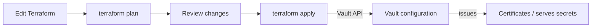

# Terraform with Vault locally

Terraform can manage Vault configuration through Vault's API. In this lab,
Terraform configures a KV v2 mount and example secret, a policy, a PKI root and
intermediate CA hierarchy, a leaf-issuing role on the intermediate, and an
AppRole.

The purpose is to describe those Vault resources as code so you can review the
changes before applying them and repeat the setup consistently.

> **Terraform does not replace Vault.** Vault still stores secrets and issues
> certificates. Terraform manages selected Vault configuration, such as mounts,
> policies, and roles.

Follow [Vault Fundamentals](./VAULT_FUNDAMENTALS.md) and
[Vault PKI](./VAULT_PKI.md) first so the resources in this chapter have context.
Use only the disposable development server described in
[Prerequisites](./PREREQUISITES.md). Do not use this example to manage a
production Vault.

## 1. Install Terraform and prepare Vault

On macOS, install Terraform with Homebrew:

```sh
brew tap hashicorp/tap
brew install hashicorp/tap/terraform
```

On Windows or Linux, follow HashiCorp's
[Terraform installation instructions](https://developer.hashicorp.com/terraform/install).

Check that Terraform is available:

```sh
terraform version
```

This example uses Terraform's write-only input support, which requires
Terraform 1.11 or later.

Start a **fresh** Vault development server as described in
[Prerequisites](./PREREQUISITES.md), then, in a second terminal, set its
connection details:

```sh
export VAULT_ADDR=http://127.0.0.1:8200
export VAULT_TOKEN=dev-only-token
vault status
```

For local use, enter a disposable lab password at a hidden prompt in the same
terminal where you will run Terraform. This avoids storing the value in a
`.env` file or shell history:

```sh
printf "Lab password: "
IFS= read -r -s TF_VAR_app_password
printf '\n'
export TF_VAR_app_password
```

The variable is both `sensitive` and `ephemeral`, and the KV provider resource
uses a write-only attribute. Together, these prevent the password value from
being saved in Terraform plan or state files. The variable exists in your
shell environment while Terraform runs, so use only a disposable learning
value. If you change the password, increment `data_json_wo_version` in
`main.tf` before planning; Terraform cannot detect changes to write-only
values automatically.

For automation, store the password in your CI platform's secret manager and
inject it as `TF_VAR_app_password` only for the Terraform job. Do not commit it
to `.tfvars`, `.tfvars.json`, `.env`, source control, or command-line
arguments. Protect Terraform state and Vault credentials even when using
write-only inputs.

The Vault provider reads `VAULT_ADDR` and `VAULT_TOKEN` from the environment.
Using a fresh server avoids collisions with mounts and roles you created by
hand in the earlier chapters. Terraform does not automatically adopt existing
Vault resources; managing existing resources requires importing them into
Terraform state.

## 2. Create the Terraform configuration

Review the starter configuration in
[terraform/main.tf](./terraform/main.tf). It declares:

- A KV v2 mount and a sample secret.
- A read policy scoped to that secret.
- A root PKI mount with an internal root CA.
- A separate intermediate PKI mount whose internal key generates a CSR; the
  root signs it and Terraform installs the signed intermediate certificate
  and configures that issuer as the intermediate mount's default.
- A leaf-issuing role on the intermediate, not on the root.
- An AppRole authentication mount and role linked to the read policy.

The configuration uses separate mount paths (`learning-kv/`, `learning-pki/`,
and `learning-pki-int/`) so it does not rely on or overwrite the development
server's default `secret/` engine.

The password you enter must be a disposable lab value. Write-only inputs
reduce secret exposure in Terraform state, but they do not make a local shell
environment, provider logs, or all Terraform artifacts suitable for production
credentials.

## 3. Format, review, and apply

Run the commands from the `terraform/` directory:

```sh
cd terraform
terraform init
terraform fmt
terraform validate
terraform plan
```

`init` downloads the Vault provider and creates a dependency lock file named
`.terraform.lock.hcl`. Keep this lock file with the project so later runs use
the same provider version.

Read the plan before continuing. Terraform should show the KV v2 mount, sample
secret, policy, root and intermediate PKI mounts, root certificate, intermediate
CSR and signed certificate, default intermediate issuer, leaf-issuing role,
AppRole auth method, and AppRole role it intends to create. If it proposes
unexpected changes, do not apply until you understand why.

Apply the reviewed configuration:

```sh
terraform apply
```

Terraform asks for confirmation. Type `yes` only after reviewing the proposed
actions. Terraform manages Vault configuration through its API:



Terraform manages Vault configuration; Vault continues to handle secret
storage and certificate issuance. In this example, the root signs the
intermediate CA, and the intermediate CA—not the root—issues leaf certificates.
The Terraform configuration selects the newly installed intermediate as the
default issuer; Vault requires this selection for both `learning-pki-int/cert/ca`
and role-based issuance.

## 4. Issue a leaf certificate from the intermediate

The lab keeps both CA mounts on the same development Vault so the workflow is
easy to reproduce. The intermediate CA key is generated as `internal` and
stays in Vault. In production, the root CA should normally be kept offline or
separately controlled; Terraform-connected Vault should manage the intermediate
and issue application certificates.

Use the Vault CLI to retrieve the public CA certificates and request a leaf
certificate from the intermediate role:

```sh
vault read -field=certificate learning-pki/cert/ca > root-ca.crt
vault read -field=certificate learning-pki-int/cert/ca > intermediate-ca.crt
vault write -field=certificate learning-pki-int/issue/internal-services \
  common_name="orders.example.internal" \
  ttl="24h" > orders.crt
```

If you had already applied this configuration before adding the default-issuer
resource, run `terraform plan` and `terraform apply` again from `terraform/`.
Terraform will set the imported intermediate as the default. Do not regenerate
or re-sign the CA just to resolve a missing default issuer. Confirm it with:

```sh
vault read learning-pki-int/config/issuers
```

The `-field=certificate` flag writes only the public certificate to `orders.crt`
and avoids displaying the generated private key. Inspect the issuer and verify
the complete chain:

```sh
openssl x509 -in orders.crt -noout -subject -issuer -dates
openssl verify -CAfile root-ca.crt \
  -untrusted intermediate-ca.crt orders.crt
```

The expected result is `orders.crt: OK`. The leaf certificate's issuer should
be the intermediate CA, demonstrating that the root does not issue application
certificates directly.

## 5. Verify the result in Vault

The CLI and browser UI can both inspect the Vault resources Terraform created.
With the root token still set in the environment, try:

```sh
vault secrets list
vault kv get learning-kv/myapp
vault policy read terraform-myapp-read
vault read learning-pki-int/roles/internal-services
vault auth list
```

Open `http://127.0.0.1:8200/ui` and sign in with the development root token to
browse the mounts and policy. As in earlier chapters, the root token can access
everything; it does not demonstrate the restrictions on an AppRole-issued
token.

To test the AppRole created by Terraform, use the root-token CLI session to
retrieve a Role ID and generate a Secret ID, then exchange them for a token:

```sh
ROLE_ID=$(vault read -field=role_id auth/approle/role/terraform-myapp/role-id)
SECRET_ID=$(vault write -f -field=secret_id auth/approle/role/terraform-myapp/secret-id)
APP_TOKEN=$(vault write -field=token auth/approle/login \
  role_id="$ROLE_ID" \
  secret_id="$SECRET_ID")
VAULT_TOKEN="$APP_TOKEN" vault kv get learning-kv/myapp
```

The AppRole token should read the sample secret because Terraform attached the
`terraform-myapp-read` policy to the role. Keep the Secret ID and token private;
these commands keep them in shell variables rather than writing them into the
project.

You can now change a non-secret setting in `main.tf`, run `terraform plan` to
see the proposed change, and use `terraform apply` to update Vault.

## 6. Clean up the lab

Destroy Terraform-managed resources **before** stopping the Vault server:

```sh
terraform destroy
```

Review the destroy plan and confirm only the lab resources should be removed.
Afterward, return to the terminal running the development server and press
**Ctrl+C**, then run `docker compose down` from the project folder. The
development server stores data only in memory, so stopping it discards the
temporary Vault data. Start it again with `docker compose up` before rerunning
the chapter.

If you stop or reset Vault before running `terraform destroy`, the local
Terraform state will no longer match the empty server. For this disposable
exercise, do not reuse that state against a newly started Vault; start with a
fresh copy of the lab directory or carefully remove the old local state only
when you are certain it contains no work you need.

## Next steps

- Move the policy into a separate `.hcl` file and load it with Terraform's
  `file()` function.
- Use Terraform to configure certificate URLs, CRLs, and additional PKI roles.
- Consider splitting root-CA administration from the online intermediate CA
  and Terraform workflow.
- Learn how to import existing resources before asking Terraform to manage
  Vault configuration that was created manually.
- In real environments, use protected remote state, least-privilege Terraform
  credentials, and a secure way to provide credentials to the provider.

See the HashiCorp
[Vault Terraform provider documentation](https://registry.terraform.io/providers/hashicorp/vault/latest/docs)
for provider setup and the full list of supported resources.
